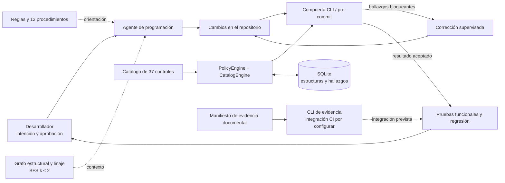

# INFORME DE AVANCE — HITO 2
## Verificación de privacidad, calibración ciega y costo en el desarrollo asistido por IA

### Portada

- **Proyecto:** Arnés de Supervisión de Software Asistido por IA mediante Grafos de Dependencias y Linaje de Datos bajo la Ley N° 21.719
- **Caso de estudio:** Validación experimental de un arnés especializado en controles técnicos de privacidad sobre un banco sintético de comercio electrónico
- **Institución:** Universidad Andrés Bello, Facultad de Ingeniería, Sede Viña del Mar — ITISB
- **Curso:** Portafolio de Proyectos / Proyecto de Título
- **Integrantes:** Andrés Tapia y Bastian Oyanedel
- **Profesor guía:** David Araya
- **Repositorio:** [https://github.com/Cliptap/compliance-graph-harness](https://github.com/Cliptap/compliance-graph-harness)
- **Fecha de actualización del informe:** 27 de noviembre de 2026
- **Fecha de corte de la evidencia:** 27 de noviembre de 2026

### Resumen ejecutivo

Un agente de programación puede completar correctamente una tarea y, al mismo tiempo, introducir un riesgo que nadie le pidió evitar, como escribir el RUT de un cliente en una bitácora. Este proyecto construye y evalúa un **arnés**: una capa de software que revisa los cambios del agente contra controles técnicos derivados de la Ley N° 21.719, sin certificar cumplimiento jurídico.

Su núcleo es un catálogo de 37 controles y una **compuerta** que analiza el código modificado y bloquea el cambio cuando encuentra una violación.

Para medir su efecto se diseñó un experimento con **trampas ocultas**: tareas aparentemente simples sobre una tienda en línea ficticia, donde la solución más directa viola un control derivado de la ley, por ejemplo, exponer datos personales en una respuesta. El agente resolvió las mismas tareas con y sin arnés, y cada resultado se verificó con pruebas que el agente no podía ver.

En el experimento principal, sin arnés, el agente cayó en la trampa en una de cada cuatro ejecuciones (6 de 24); con la compuerta activa, en ninguna (0 de 24). Un experimento anterior mostró el mismo patrón y, con un segundo modelo de lenguaje, las caídas bajaron de 6 a 2 de cada 12 ejecuciones. El detector también se evaluó con casos escritos sin acceso a su código: en la medición final identificó todas las violaciones, con dos falsas alarmas en 84 casos.

La protección tiene un costo: el agente tardó entre 1,7 y 2,5 veces más y consumió entre 2,3 y 3,3 veces más recursos del modelo. La evidencia atribuye el beneficio a la verificación automática, no de dar más instrucciones al agente. Los resultados se limitan a muestras pequeñas, tareas sintéticas y solo dos modelos de lenguaje; las secciones 6 y 10 detallan el diseño y el análisis.

# 1. INTRODUCCIÓN

El desarrollo asistido por inteligencia artificial ha evolucionado desde el autocompletado hacia agentes capaces de inspeccionar repositorios, ejecutar herramientas y modificar sistemas de software. Esta autonomía desplaza parte del trabajo humano desde escribir cada línea hacia especificar intención, suministrar contexto y verificar resultados. También introduce un problema concreto: una implementación puede satisfacer las pruebas funcionales y, a la vez, exponer datos personales en bitácoras, respuestas de API o procesos de eliminación.

El proyecto aborda ese problema mediante un **arnés de verificación especializado en privacidad**. El arnés no reemplaza al desarrollador ni emite juicios jurídicos. Su función es convertir un subconjunto explícito de obligaciones y buenas prácticas en controles que puedan inspeccionarse sobre el código o exigirse como evidencia documental. Cuando una condición no puede demostrarse automáticamente, el sistema la declara como riesgo, evidencia o revisión manual, en lugar de simular certeza.

La iniciativa parte de una aplicación clínica construida durante el semestre anterior mediante *prompts* y *skills*. Esa experiencia hizo visibles cambios fuera de alcance, dependencias innecesarias y dificultades para revisar código generado. El prototipo incorporó posteriormente grafos estructurales, linaje de datos, reglas permanentes y procedimientos de desarrollo. El presente hito concentra su contribución en la dimensión normativa y en la evaluación empírica: determinar qué componente reduce violaciones técnicas, con qué confiabilidad y a qué costo.

La Ley N° 21.719 modifica la Ley N° 19.628 e incorpora, entre otros deberes, la protección desde el diseño y por defecto y la adopción de medidas de seguridad. Su entrada en vigencia quedó fijada para el **15 de octubre de 2027** por la Ley N° 21.855, publicada el 23 de noviembre de 2026 \[23\]. Las referencias a artículos como 14 quáter y 14 quinquies corresponden al texto de la Ley N° 19.628 **reformado por la Ley N° 21.719** \[1\]\[2\].

El informe sigue la pauta acumulativa del curso como guía de contenidos, no como una secuencia rígida. Las secciones 2 a 5 presentan problema, objetivos, alcance y fundamentos; la sección 6 unifica el diseño metodológico; las secciones 7 a 9 documentan gestión, solución e incrementos; la sección 10 separa resultados de interpretación; y las secciones 11 y 12 cierran con discusión, conclusiones, referencias y anexos.

**Convenciones de lectura.** Se usa «arnés» como traducción de *harness*. Una «compuerta» es un punto de control que acepta o bloquea un cambio. Un «brazo» es una configuración experimental. Un «control» es una condición verificable; no equivale por sí solo a una obligación legal completa. «Oráculo» designa el conjunto de pruebas y reglas separadas del detector usado para clasificar resultados experimentales, no una autoridad jurídica. El «banco oculto» es ese material de evaluación, que el agente no debe ver; una «lectura del banco» es una ejecución en la que el agente llegó a abrir alguno de esos archivos. Los términos técnicos adicionales se definen en el Anexo A.

# 2. PROBLEMA U OPORTUNIDAD

## 2.1 Situación actual

Un agente de programación optimiza el encargo que recibe, pero el encargo suele ser incompleto. Si se le pide «agregar un registro para depurar el inicio de sesión», puede incluir correos, tokens o identificadores sin que exista una intención maliciosa ni un error de compilación. El sistema resultante puede funcionar correctamente y vulnerar una restricción de privacidad que nadie escribió en la tarea.

Este riesgo no se resuelve únicamente con más instrucciones. Las reglas declarativas orientan al modelo, pero no comprueban el resultado. Para verificar una condición se requiere un mecanismo independiente que inspeccione el cambio y produzca evidencia reproducible. En el proyecto, esa diferencia se expresa así:

- **Instrucción:** indica al agente qué debería hacer; su cumplimiento no está garantizado.
- **Política:** define una condición que el sistema puede evaluar.
- **Compuerta:** aplica la política y decide si el cambio puede continuar.
- **Evidencia:** permite auditar qué se evaluó y con qué resultado.
- **Supervisión humana:** mantiene la decisión y la responsabilidad final.

La experiencia previa del equipo aporta el contexto de ingeniería: controlar alcance, contexto y arquitectura sigue siendo relevante. Sin embargo, el problema central investigado en este informe es más específico: **la ausencia de verificación sistemática de requisitos técnicos de privacidad en cambios producidos por agentes**.

## 2.2 Brecha

Las herramientas existentes cubren partes del problema. Los asistentes generan código; los agentes ejecutan tareas; los analizadores estáticos encuentran patrones; los grafos representan dependencias; y los procedimientos documentan cómo trabajar. La necesidad no resuelta es integrar esas capacidades en un flujo que:

1. derive controles explícitos de un marco normativo;
2. distingua detecciones automáticas de juicios que requieren evidencia o revisión humana;
3. entregue retroalimentación durante el desarrollo;
4. mida tanto el beneficio como el costo de la intervención; y
5. permita auditar la calidad del propio verificador.

La oportunidad académica consiste en evaluar no solo el artefacto, sino también sus límites. Una compuerta puede reducir violaciones y, al mismo tiempo, producir falsos positivos, omitir flujos entre archivos o aumentar innecesariamente el costo cuando el agente ya resuelve bien la tarea.

## 2.3 Pregunta del proyecto

> **¿En qué medida un arnés especializado en la Ley N° 21.719 reduce las violaciones técnicas de privacidad introducidas por un agente de programación, frente a un agente sin arnés; qué componente explica el efecto observado; con qué confiabilidad detecta esas condiciones; y a qué costo de tiempo y tokens?**

La pregunta se descompone en cuatro preguntas operativas:

- **P1 — Efecto y atribución:** ¿las reglas, los procedimientos o la compuerta reducen las violaciones confirmadas?
- **P2 — Calidad del verificador:** ¿qué precisión y exhaustividad alcanza el detector fuera del corpus con el que fue desarrollado?
- **P3 — Costo y función:** ¿la intervención preserva la completitud funcional y cuánto incrementa el tiempo y el consumo de tokens?
- **P4 — Cobertura normativa:** ¿qué obligaciones se detectan, cuáles exigen evidencia y cuáles permanecen bajo revisión humana?

El componente de grafos estructurales forma parte del artefacto, pero no tiene un brazo experimental independiente. Por tanto, su efecto causal queda fuera de la respuesta empírica de este informe.

# 3. OBJETIVOS

## 3.1 Objetivo general

Diseñar, implementar y evaluar un arnés de gobernanza especializado en la Ley N° 21.719 para el desarrollo de software asistido por IA, que traduzca deberes seleccionados en controles técnicos verificables y permita medir su efecto sobre las violaciones de privacidad, la preservación funcional y el costo de ejecución, frente a una asistencia generativa no gobernada.

## 3.2 Objetivos específicos

- **OE1 — Procedimientos y gobernanza de decisiones:** formalizar doce procedimientos de desarrollo (`01-prd` a `12-documentation`) y tres de cumplimiento, con criterios explícitos de activación, ejecución y verificación.
- **OE2 — Gestión estructural de contexto:** construir un mecanismo basado en grafos de dependencias y recorridos de vecindad acotada para seleccionar contexto y apoyar el análisis de flujos de datos sensibles; distinguir su implementación de la evaluación de su efecto aislado.
- **OE3 — Arquitectura desacoplada y roles especializados:** consolidar un núcleo parametrizable para repositorios Python compatibles y definir roles de planificación, revisión de código, seguridad y cumplimiento bajo supervisión humana.
- **OE4 — Catálogo y validación de privacidad:** formalizar controles trazables, motores de detección, validación, compuerta de integración y remediación supervisada, declarando explícitamente los controles que requieren evidencia o juicio humano.
- **OE5 — Evaluación empírica:** ejecutar protocolos comparativos que midan violaciones confirmadas, fallas de comportamiento, pruebas funcionales, calidad del detector, tokens, tiempo y amenazas a la validez.

La sección 7.4 vincula estos objetivos con requisitos y evidencias; la sección 11.2 evalúa su cumplimiento sin equiparar disponibilidad técnica con validación causal.

# 4. JUSTIFICACIÓN Y ALCANCE

## 4.1 Justificación

**Valor técnico.** El proyecto transforma parte de la gobernanza declarativa en verificación ejecutable. El catálogo no está codificado como una lista rígida dentro del motor: se carga como datos, lo que permite revisar obligaciones, detectores y evidencias sin reescribir el núcleo. La compuerta entrega retroalimentación antes de integrar cambios y conserva resultados inspeccionables.

**Valor metodológico.** El trabajo evalúa el verificador además del agente. El protocolo distingue corpus de desarrollo, corpus ciego y regresión; registra resultados antes de las correcciones; separa pruebas ocultas del mecanismo evaluado; y reporta intervalos y análisis de sensibilidad. Este diseño evita que un resultado favorable se obtenga simplemente ajustando el instrumento después de medir.

**Valor normativo y social.** El proyecto muestra cómo apoyar técnicamente deberes de confidencialidad, seguridad, minimización, retención y derechos de titulares. La relevancia aumenta ante la entrada en vigencia de la reforma el 15 de octubre de 2027 \[1\]\[23\]. El arnés no determina licitud ni sanciones y no reemplaza una evaluación jurídica: reduce un conjunto acotado de riesgos técnicos.

**Valor académico.** La investigación aporta un artefacto, datos experimentales y una lectura crítica de sus componentes. El resultado más relevante no es que «más instrucciones» mejoren al agente, sino que la evidencia disponible atribuye el efecto principalmente a una capa de verificación y muestra que esa capa tiene un costo medible.

## 4.2 Alcance

El proyecto comprende tres elementos diferenciados:

1. **Arnés especializado — producto principal**
   - Doce procedimientos de desarrollo y tres de cumplimiento.
   - Reglas permanentes de consulta, foco MVP, verificación de dependencias y simplicidad.
   - Grafo estructural de archivos, clases, funciones, importaciones y llamadas; recorrido BFS acotado (`k ≤ 2`).
   - Análisis heurístico de linaje y flujos entre fuentes y sumideros.
   - Catálogo consolidado de 37 controles y motores de políticas.
   - Compuerta de *pre-commit* y verificación de evidencia documental.
   - Persistencia SQLite, contratos de datos y visualización.
   - Verificación automatizada documentada en el Anexo C.

2. **Aplicación clínica — demostrador transaccional**
   - API REST con FastAPI, persistencia relacional asíncrona y contratos OpenAPI.
   - Gestión de pacientes, profesionales, citas y auditoría.
   - Validación de RUT mediante Módulo-11, prevención de colisiones y RBAC con tokens firmados.
   - Datos exclusivamente sintéticos y validación funcional automatizada.
   - No constituye el banco principal de los experimentos de dosis y replicación.

3. **Banco experimental — comercio electrónico sintético**
   - Aplicación «Dumbo», tareas con trampas de privacidad y variantes con defectos.
   - Pruebas ocultas y reglas Semgrep separadas del detector del arnés, con autoría compartida declarada como limitación.
   - Corpus ciegos sellados y reportes por ejecución.

**Usuarios previstos.** Desarrolladores e ingenieros de software utilizan el arnés desde línea de comandos y entorno de desarrollo. Auditores y responsables de protección de datos son destinatarios potenciales de los reportes; no se afirma que exista una plataforma autónoma de auditoría jurídica.

**Entorno verificado.** Python 3.11 o superior como requisito declarado y Python 3.13 en la validación final, Pytest 9.0.3 y SQLite embebido. Los experimentos utilizan OpenCode en modo no interactivo y modelos fijados por bloque.

## 4.3 Fuera de alcance

1. Certificación jurídica automática o asesoría legal formal.
2. Soporte integral de lenguajes distintos de Python.
3. Orquestación autónoma completa entre roles especializados.
4. *Fine-tuning* o entrenamiento de modelos.
5. Infraestructura de despliegue *cloud* o aislamiento empresarial.
6. Frontend clínico de usuario final como producto evaluado.
7. Demostración causal del efecto de grafos estructurales o linaje en los experimentos actuales.
8. Evaluación de conducta de revisión humana, esfuerzo de revisión o adopción por equipos reales.

# 5. ESTADO DEL ARTE, MARCO CONCEPTUAL Y BRECHA

## 5.1 Desarrollo asistido por IA y *harness engineering*

Los asistentes de código, como Copilot, Cursor y Windsurf, combinan autocompletado, conversación y edición según producto y configuración. Los agentes de ingeniería de software amplían esa capacidad: SWE-agent, Devin y OpenHands interactúan con repositorios y herramientas para ejecutar tareas. SWE-agent formaliza la importancia de la interfaz entre agente y computador \[11\].

El concepto de *harness engineering* desplaza la atención desde el modelo aislado hacia el entorno que lo hace verificable. OpenAI describe la importancia del contexto, las herramientas, la estructura del repositorio y los ciclos de retroalimentación \[14\]. Zhong y Zhu proponen el *harness* como una capa de ejecución que media entre modelo, proyecto y entorno, con responsabilidades de selección de contexto, permisos, observabilidad y verificación \[15\].

El proyecto adopta esa perspectiva con un alcance acotado: no construye una plataforma general para cualquier agente, sino un arnés especializado en controles técnicos de privacidad.

## 5.2 *Agent Skills* y procedimientos especializados

La especificación abierta de *Agent Skills* define una carpeta con `SKILL.md`, metadatos obligatorios de nombre y descripción, y recursos opcionales. Su modelo de carga progresiva permite descubrir capacidades por metadatos y cargar instrucciones o recursos cuando la tarea los requiere \[12\]\[13\].

Los doce procedimientos del proyecto organizan el ciclo desde requisitos hasta documentación y adoptan una anatomía práctica con descripción, flujo y criterios de verificación \[16\]. Esta estructura hace explícito el trabajo, pero una *skill* no constituye una garantía: sigue siendo texto que orienta al modelo. La distinción entre orientar y verificar es central para interpretar los resultados experimentales.

## 5.3 Contexto estructural y linaje

La recuperación textual o por similitud selecciona fragmentos relevantes según contenido. Un grafo estructural representa, además, relaciones explícitas entre archivos, símbolos, importaciones y llamadas. El proyecto utiliza este segundo enfoque para acotar vecindades mediante BFS (`k ≤ 2`) y apoyar el análisis de dependencias.

La implementación actual puede serializar archivos completos asociados a los nodos seleccionados. Por ello, no equivale a extracción fina de símbolos ni a *program slicing* semántico en el sentido de Weiser \[10\]. Tampoco se afirma superioridad universal sobre RAG: son mecanismos que pueden complementarse.

El linaje de datos identifica posibles fuentes y sumideros mediante heurísticas. Es útil para priorizar revisión, pero no representa todos los flujos dinámicos ni todos los enlaces entre módulos.

## 5.4 *Compliance as Code* y análisis estático de privacidad

*Compliance as Code* consiste en expresar controles en artefactos ejecutables y verificables. Semgrep permite definir reglas estáticas y, según su configuración, análisis de flujo. Sus hallazgos requieren adjudicación: una coincidencia textual no siempre demuestra una violación, y una regla no detecta lo que no fue escrita para reconocer.

Tres trabajos delimitan la comparación directa:

- **Paralegal** detecta problemas de privacidad en Rust mediante un grafo de dependencias del programa y marcadores de políticas; fue evaluado sobre ocho aplicaciones reales y comparado con CodeQL y control de flujo de información \[20\].
- **Tang, Østvold y Bruntink** identifican datos personales y su procesamiento para priorizar revisión; reportan precisión 0,87 sobre cuatro aplicaciones y no estiman exhaustividad por falta de verdad de referencia \[21\].
- **GDPR-Bench-Android** reúne 1.951 instancias anotadas de quince repositorios y compara once métodos, incluidos modelos, RAG y un agente. Sus resultados muestran que ningún paradigma domina todas las tareas \[22\].

El presente proyecto difiere en tres aspectos: deriva los controles de la legislación chilena; evalúa el efecto de la compuerta sobre código producido por agentes; y calibra el detector con rondas ciegas selladas antes de cada medición. Su escala de código real es menor, limitación que se mantiene explícita.

## 5.5 Comparación de enfoques

| Dimensión | Asistentes y agentes | SAST / reglas estáticas | Directivas y procedimientos | Arnés propuesto |
| - | - | - | - | - |
| Propósito principal | Generar y modificar código. | Detectar patrones o flujos definidos. | Orientar decisiones y secuencia de trabajo. | Prevenir y auditar condiciones técnicas de privacidad durante el desarrollo. |
| Verificación | Depende de herramientas configuradas. | Determinista respecto de cada regla. | No verifica por sí sola el resultado. | Catálogo, políticas, compuerta y evidencia. |
| Contexto | Editor, repositorio y herramientas. | No es su función principal. | Depende de lo suministrado. | Grafo BFS acotado; puede incluir archivos completos. |
| Cobertura normativa | Requiere configuración específica. | Depende de las reglas escritas. | Puede documentar obligaciones. | Correspondencia explícita con artículos y modo de verificación. |
| Trazabilidad | Varía según producto y entorno. | Produce hallazgos. | Conserva instrucciones y decisiones. | Vincula controles, archivos, resultados y evidencias. |
| Límite compartido | Puede omitir restricciones no solicitadas. | Falsos positivos y cobertura incompleta. | Puede ser ignorada por el modelo. | No certifica cumplimiento jurídico ni cubre todos los flujos. |

## 5.6 Brecha y contribución

La brecha abordada es la falta de una capa que combine **controles normativos explícitos + verificación durante el desarrollo + evaluación del propio detector + medición de costo**. La contribución no consiste en afirmar que cada componente es nuevo de forma aislada, sino en construir y evaluar su integración bajo un protocolo que permite distinguir efecto, confiabilidad y límites.

Model Context Protocol (MCP) se considera únicamente como una futura vía de interoperabilidad para exponer herramientas y recursos \[17\]\[18\]. No forma parte del mecanismo evaluado ni es necesario para reproducir los resultados.

# 6. METODOLOGÍA

## 6.1 Enfoque de investigación

Se adoptó **Investigación en Ciencia del Diseño** (*Design Science Research*, DSR), complementada con ingeniería de software empírica. DSR resulta apropiado porque el trabajo construye un artefacto para un problema práctico y lo evalúa de forma iterativa \[7\]\[8\]\[9\].

El ciclo comprendió:

1. identificación del problema y de los controles;
2. diseño e implementación del arnés;
3. demostración sobre bancos sintéticos;
4. evaluación comparativa y calibración;
5. corrección del artefacto sin reescribir las mediciones históricas; y
6. comunicación de resultados, costos y amenazas a la validez.

El artefacto principal reúne procedimientos, reglas, análisis estructural, catálogo normativo, motores de políticas, compuerta, evidencia y persistencia.

## 6.2 Diseño general y unidades de análisis

Se ejecutaron seis estudios principales y una extensión de sensibilidad. En términos simples: E1 y E2 comparan al agente con y sin arnés sobre tareas con trampas de privacidad; E3 evalúa si el detector reconoce violaciones que no conocía; E4 mide cuánto cuesta el arnés cuando el agente ya resuelve bien; E5 repite la comparación principal en un entorno aislado; y E6 y E7 comprueban si el resultado se mantiene con otro modelo y en modo autónomo. No se combinan sus muestras porque cambian tareas, fecha, modelo o instrumento.

| ID | Propósito | Diseño ejecutado | Modelo | Evidencia principal |
| :-: | - | - | - | - |
| **E1** | Comparación formal | 12 tareas × 3 brazos × 3 repeticiones = **108 ejecuciones**. Orden de brazos mezclado con semilla fija. | `deepseek-v4.1-flash` | `qa_reports/formal-opencode/` |
| **E2** | Dosis y atribución | 4 tareas × 5 brazos × 5 repeticiones = **100 ejecuciones**. | `deepseek-v4.1-flash` | `qa_reports/formal-dose/` |
| **E3** | Calibración del detector | 21 rondas ciegas selladas; **907 casos** sobre 7 controles. Cada caso se midió una vez antes de corregir. | Autores y detector evaluado en el entorno del proyecto | `harness/eval/blind/` y `qa_reports/catalog-corpus/` |
| **E4** | Función, evidencia y costo | 10 trampas × 2 brazos × 3 repeticiones = **60 ejecuciones**, más 6 repeticiones posteriores de D03. Sin aleatorización. | `deepseek-v4.1-flash` | `qa_reports/consolidation/` |
| **E5** | Replicación aislada | 4 tareas × 3 brazos × 6 repeticiones = **72 ejecuciones**, sin acceso registrado al banco oculto. | `deepseek-v4.1-flash` | `qa_reports/clean-env/` y `docs/research/gate-only-arm.md` |
| **E6** | Segundo modelo | 4 tareas × 3 brazos × 3 repeticiones = **36 ejecuciones**, con el mismo aislamiento. | `gpt-6-luna` | `qa_reports/model-gpt6luna/` y `docs/research/gate-only-arm.md` |
| **E7** | Sensibilidad al modo autónomo | 12 ejecuciones adicionales del brazo con cláusula *headless*, contrastadas con el brazo completo de E6. | `gpt-6-luna` | `qa_reports/model-gpt6luna/` y `docs/research/gate-only-arm.md` |

Los identificadores de modelo incluyen en los manifiestos el prefijo `opencode-go/`, que identifica la vía de acceso usada por OpenCode y no al desarrollador del modelo. `deepseek-v4.1-flash` (DeepSeek) y `gpt-6-luna` (OpenAI) pertenecen a empresas y familias de modelos distintas. Aun así, E6 y E7 son evidencia exploratoria de robustez: dos modelos con muestras desiguales no constituyen una validación amplia entre modelos.

La unidad de análisis de E1, E2, E5 y E6 es la ejecución pareada por tarea y repetición. En E3 es el caso etiquetado. En E4 el costo se resume por ejecución y por tarea. Las repeticiones de una misma tarea pueden ser dependientes; esta estructura limita la inferencia y se considera al interpretar los valores *p*.

## 6.3 Configuraciones experimentales

| Brazo | Reglas | 12 procedimientos | 3 procedimientos de cumplimiento | Compuerta e instrucción | Corrección externa |
| - | :-: | :-: | :-: | :-: | :-: |
| `baseline` | No | No | No | No | No |
| `harness` | Sí | Sí | No | No | No |
| `harness_compliance` | Sí | Sí | Sí | Sí | Hasta 3 rondas |
| `rules` | Sí | No | No | No | No |
| `rules_skills` | Sí | Sí | No | No | No |
| `rules_skills_gate` | Sí | Sí | Sí | Sí | No |
| `rules_skills_gate_enforced` | Sí | Sí | Sí | Sí | Hasta 3 rondas |
| `gate_only` | No | No | No | Sí | No |
| `rules_skills_headless` | Sí, con cláusula autónoma | Sí | Sí | Sí | No |

E1 utiliza los tres primeros brazos; E2 los cinco de dosis; E4 compara `baseline` y `rules_skills_gate`; E5 y E6 comparan `baseline`, `gate_only` y `rules_skills_gate`. E7 sustituye la espera de confirmación por una cláusula que ordena continuar con la opción más conservadora y documentar el supuesto.

La compuerta experimental es una herramienta de línea de comandos basada en `PolicyEngine` y `CatalogEngine`. Analiza los archivos modificados mediante AST y catálogo, sin acceder a las pruebas ocultas ni al oráculo. No debe confundirse con el *hook* de *pre-commit*, que opera sobre el índice de Git. El experimento no utiliza el grafo estructural para seleccionar contexto.

## 6.4 Oráculo y clasificación

El oráculo combina pruebas ocultas y reglas Semgrep escritas fuera del motor del arnés. La clasificación por ejecución es:

|  | Semgrep encuentra una violación | Semgrep no encuentra una violación |
| - | - | - |
| **La prueba oculta falla** | `confirmed_violation`: violación técnica confirmada por ambas señales. | `behavioral_failure`: requiere distinguir tarea incompleta, artefacto de prueba o privacidad no cubierta por Semgrep. |
| **La prueba oculta pasa** | `latent_risk`: hallazgo que requiere revisión; puede ser falso positivo. | `clean`: ninguna de las dos señales detecta un problema. |

«Confirmada» es una etiqueta operacional del experimento, no una prueba de infracción jurídica ni una garantía de que el oráculo cubra todas las violaciones. Los hallazgos Semgrep son conteos de detecciones y no equivalen necesariamente a una ejecución: una misma ejecución puede generar varios hallazgos.

Las correcciones posteriores de T05, T33, T34 y D03 se documentan en el Anexo F. Los datos crudos permanecen disponibles y no se presentan como si hubieran sido producidos por el instrumento corregido.

## 6.5 Calibración ciega del detector

El corpus inicial de 22 casos fue escrito junto al detector y solo se utiliza como prueba de humo. Para medir generalización, cada ronda ciega fue creada por un autor sin acceso al repositorio ni a los corpus anteriores, sellada con SHA-256 y evaluada una sola vez. El resultado anterior a cualquier corrección es la medición; los casos corregidos pasan posteriormente a regresión.

Las 21 rondas cubren los siete controles `v2.*` y módulos de 20 a 55 líneas. La serie completa no se agrega como una única muestra, porque el detector cambió después de cada ronda. La estimación principal corresponde a la ronda 21, con 84 casos neutrales y el detector previo a sus dos últimas correcciones.

Como comparación, se ejecutaron sobre esos mismos 84 casos las quince reglas Semgrep usadas por el proyecto. Esta comparación evalúa **las reglas disponibles**, no el máximo rendimiento posible del motor Semgrep ni su modo *taint*.

## 6.6 Métricas y análisis estadístico

**Resultados de agente.** Violaciones confirmadas, fallas de comportamiento, riesgos latentes, ejecuciones limpias, pruebas ocultas aprobadas, llamadas a compuerta y tiempos agotados.

**Costo.** Tiempo de ciclo y tokens totales. Los tokens son una medida de consumo del modelo, no una tarifa monetaria. E1 y E2 reportan medias y totales; E4, E5, E6 y E7 priorizan medianas. Las razones de costo se calculan dentro de cada bloque y no se combinan.

**Calidad del detector.** Para cada control se cuentan verdaderos positivos (VP), falsos positivos (FP), falsos negativos (FN) y verdaderos negativos (VN):

- Precisión = VP / (VP + FP): proporción de hallazgos que eran violaciones etiquetadas.
- Exhaustividad o *recall* = VP / (VP + FN): proporción de violaciones etiquetadas detectadas.
- Exactitud = (VP + VN) / total.

**Inferencia.** Los contrastes binarios pareados utilizan la prueba exacta bilateral de McNemar sobre pares discordantes. En las tablas, «mejora/empeora» indica cuántos pares cambian en cada dirección respecto de la referencia. El valor *p* expresa la compatibilidad de los datos con la ausencia de diferencia; no es la probabilidad de que la hipótesis sea verdadera ni mide el tamaño del efecto. Los intervalos de proporciones son de Wilson al 95 %, apropiados para muestras pequeñas y proporciones cercanas a 0 o 1: resumen un rango de valores compatibles con los datos bajo el método utilizado, no una certeza sobre la proporción real. La dirección del costo en E4 se evalúa con una prueba de signos bilateral sobre las diez tareas. El acuerdo de etiquetas usa kappa de Cohen.

Los valores *p* se reportan sin corrección por multiplicidad y con potencia limitada. Se interpretan como evidencia propia de cada contraste exploratorio, no como confirmación de toda una familia de hipótesis. La significancia se acompaña siempre de tamaños de muestra y análisis de sensibilidad cuando corresponde.

## 6.7 Datos, ética y trazabilidad

- Todos los datos transaccionales son sintéticos. Los RUT ficticios son matemáticamente válidos bajo Módulo-11; no se utilizan fichas clínicas, credenciales ni identificadores reales.
- El agente no recibe las pruebas ocultas ni las reglas del oráculo en los brazos reportados como aislados.
- Las ejecuciones conservan configuración, tarea, modelo, resultado, consumo y clasificación en `qa_reports/`.
- Los corpus ciegos y sus sellos se conservan en `harness/eval/blind/`; los resultados posteriores se identifican como regresión.
- La revisión normativa deriva de fuentes primarias y queda con `legal_review: pending`; no constituye asesoría jurídica.

## 6.8 Criterios de éxito

1. Reducir violaciones confirmadas respecto de la línea base, reportando contraste pareado y tamaño muestral.
2. Preservar la funcionalidad mediante pruebas ocultas y la suite de regresión.
3. Medir el costo de tiempo y tokens junto con cualquier beneficio.
4. Estimar la calidad del detector fuera del corpus de desarrollo y documentar falsos positivos y negativos.
5. Hacer trazables modelo, tareas, configuración, resultados, correcciones y límites.
6. Declarar qué controles no pueden automatizarse y qué tipo de evidencia requieren.

# 7. PLANIFICACIÓN Y GESTIÓN

## 7.1 Hitos y estado

La pauta institucional define semanas de referencia. Este informe corresponde al Hito 2 y consolida todo el avance posterior al Hito 1; su entrega es el 27 de noviembre de 2026.

| Hito | Semana de referencia | Contenido y evidencia vinculada | Estado |
| - | - | - | :-: |
| **Hito 0** | 21 de septiembre | Definición, alcance, estado del arte inicial y línea base *As-Is*. | Completado |
| **Hito 1** | 12 de octubre | Primer incremento: catálogo, políticas, validación, compuerta y primeros experimentos (E1 y E2). | Completado |
| **Hito 2** | Entrega: 27 de noviembre | Segundo incremento: correcciones derivadas del Hito 1, calibración ciega del detector (E3), función y costo (E4), replicación aislada (E5), segundo modelo (E6) y modo autónomo (E7). | Entregado |
Las etiquetas y los reportes del repositorio identifican el estado técnico de cada bloque por fecha. La consolidación documental no modifica retroactivamente los datos.

## 7.2 Backlog y responsabilidades

Ambos integrantes comparten diseño, implementación, revisión de pruebas, análisis experimental y redacción. El backlog se concentra en las dependencias que afectan la validez del resultado.

| ID | Tarea | Prioridad | Estado |
| - | - | :-: | :-: |
| TK-01 | Desacoplar aplicación clínica y núcleo del arnés. | Alta | Completado |
| TK-02 | Parametrizar motores y directorios de análisis. | Alta | Completado |
| TK-03 | Consolidar la suite modular del arnés y del demostrador clínico. | Alta | Completado |
| TK-04 | Mantener integridad de los doce procedimientos y tres de cumplimiento. | Alta | Completado; validación integral en IDE en curso |
| TK-05 | Implementar catálogo, políticas, compuerta y evidencia. | Alta | Completado con brechas declaradas |
| TK-06 | Ejecutar E1 y E2. | Alta | Completado |
| TK-07 | Ejecutar calibración, costo, replicación y segundo modelo (E3–E7). | Alta | Completado |
| TK-08 | Incorporar adjudicación humana independiente. | Alta | Pendiente |
| TK-09 | Ampliar evaluación a más repositorios reales y proveedores. | Media | Pendiente |
| TK-10 | Completar visualizador de dependencias y resultados. | Media | Pendiente |

## 7.3 Riesgos y mitigación

| Riesgo | Nivel | Mitigación aplicada o pendiente |
| - | :-: | - |
| Saturación de contexto por grafos extensos. | Alto | Mantener `k ≤ 2`, medir contexto y evolucionar hacia selección por símbolos. |
| Regresiones introducidas por agentes. | Crítico | Ejecutar pruebas por cambio y suite completa antes de integrar. |
| Variabilidad temporal de modelos. | Alto | Fijar modelo por bloque, repetir tareas, registrar fecha y no mezclar corridas. |
| Contaminación del banco oculto. | Alto | Aislar el paquete por ejecución, auditar comandos y proponer contenedores. |
| Adjudicación compartida y falsos positivos. | Alto | Incorporar evaluación independiente y, como tarea pendiente, revisión humana. |
| Baja potencia y multiplicidad. | Alto | Reportar pares, intervalos, valores exactos y sensibilidad; evitar afirmaciones globales. |
| Cobertura normativa sobredimensionada. | Alto | Separar detección, riesgo, evidencia y revisión manual; mantener revisión jurídica pendiente. |

## 7.4 Matriz de trazabilidad

| Objetivo | Requisitos asociados | Evidencia verificable | Situación al cierre |
| - | - | - | - |
| OE1 | RF-H01 y RF-H02 | Doce procedimientos, tres de cumplimiento y reglas permanentes. | Implementado; validación integral en IDE pendiente |
| OE2 | RF-H03 y RF-H04 | Motor de grafos, BFS, linaje y pruebas. | Implementado; efecto aislado no evaluado |
| OE3 | RF-H05 | Núcleo parametrizable y suite de regresión del arnés. | Desacoplamiento verificado; roles bajo supervisión |
| OE4 | RF-H06 a RF-H08, RS-01 y RS-02 | Catálogo de 37 controles, motores, compuerta y evidencia. | Operativo con cobertura y revisión jurídica delimitadas |
| OE5 | RNF-01 a RNF-03 | E1–E7, reportes, corpus, análisis y verificación de regresión. | Evaluación ejecutada; generalización limitada |

# 8. DISEÑO DE LA SOLUCIÓN

## 8.1 Requerimientos del arnés

| ID | Requisito | Criterio de aceptación |
| - | - | - |
| **RF-H01** | Catálogo de procedimientos (`01-prd` a `12-documentation`). | Las doce carpetas están disponibles e íntegras; la validación completa en IDE se declara pendiente. |
| **RF-H02** | Directivas permanentes de consulta, MVP, dependencias y simplicidad. | Están disponibles para el agente; las condiciones comprobables se verifican por separado. |
| **RF-H03** | Indexación AST y grafo estructural persistente. | Se construye y almacena el grafo sobre directorios configurados. |
| **RF-H04** | Recorrido BFS acotado (`k ≤ 2`). | Se obtiene una vecindad acotada; se documenta que puede serializar archivos completos. |
| **RF-H05** | Motor parametrizable. | Opera sobre los repositorios Python de los bancos sin rutas de aplicación fijas en el núcleo. |
| **RF-H06** | Auditoría de controles de privacidad. | Reporta hallazgos con control, archivo y ubicación, sujetos a clasificación. |
| **RF-H07** | Validación y remediación supervisada. | Un cambio se acepta solo cuando satisface las políticas y pruebas configuradas; las fallas conservan evidencia. |
| **RF-H08** | Compuerta de *pre-commit*. | Rechaza el *commit* ante una violación bloqueante y entrega el motivo. |

## 8.2 Requerimientos del demostrador clínico

| ID | Requisito | Criterio de aceptación |
| - | - | - |
| **RF-C01** | Gestión de pacientes, profesionales, citas y auditoría. | Respuestas REST tipificadas con Pydantic y contratos OpenAPI. |
| **RF-C02** | Validación canónica de RUT. | Rechazo de formato o dígito verificador inválido mediante Módulo-11. |
| **RF-C03** | Prevención de colisiones de agenda. | Rechazo de reservas incompatibles y consistencia transaccional. |
| **RF-C04** | RBAC y autenticación JWT. | Denegación cuando el token carece de permisos. |

## 8.3 Requisitos no funcionales y de seguridad

| ID | Tipo | Criterio de verificación |
| - | - | - |
| **RNF-01** | Reproducibilidad | Registro de modelo, configuración, tareas, repeticiones, métricas y resultados. |
| **RNF-02** | Modularidad de pruebas | Ejecución por área y suite integral. |
| **RNF-03** | Preservación funcional | Pruebas ocultas y regresión aprobadas en el estado verificado. |
| **RS-01** | Confidencialidad | Análisis de fuentes y sumideros asociados a CWE-532 y CWE-200, con adjudicación. |
| **RS-02** | Retención clínica | Impedir eliminación irreversible antes del plazo aplicable de quince años y permitir revisión y eliminación posterior segura \[3\]\[4\]. |

## 8.4 Arquitectura



La arquitectura separa cuatro responsabilidades: orientar al agente, seleccionar contexto, verificar condiciones y conservar evidencia. Los roles *planner*, *code reviewer*, *security reviewer* y *compliance auditor* están especificados, pero su coordinación no constituye un sistema multiagente autónomo.

Los bancos clínico y de comercio electrónico permanecen fuera del núcleo. Esto permite evaluar el motor sin incorporar su lógica de negocio, aunque los detectores todavía dependen de categorías, convenciones y parámetros declarados en el catálogo.

## 8.5 Catálogo normativo y modos de verificación

El pack sectorial contiene **30 controles normativos** y el catálogo consolidado agrega **7 detectores técnicos `v2.*`**, para un total de 37 entradas. El catálogo declara qué se verifica, la fuente normativa o técnica, el detector asociado y el modo de comprobación. Las referencias técnicas incluyen CWE-532, CWE-200 y controles ISO/IEC 27001:2022, utilizados como apoyo de ingeniería y no como equivalencias legales automáticas \[5\]\[6\]\[29\].

| Modo en el pack sectorial | Controles | Significado |
| - | -: | - |
| Detectar | 15 | Produce hallazgo con ubicación; bloquea cuando severidad y estado así lo configuran. |
| Detectar como riesgo | 5 | Reporta una señal sin afirmar por sí sola una violación. |
| Exigir evidencia | 6 | Requiere artefacto, responsable y vigencia; la validación CLI está operativa y su integración obligatoria en CI depende del proyecto adoptante. |
| Revisión manual | 4 | Exige juicio humano documentado. |
| **Total** | **30** | No equivale a cobertura integral de la legislación. |

En el consolidado de 37 entradas, **26 tienen detector implementado**: 19 controles del pack (14 en modo detectar y 5 de riesgo) y los 7 detectores `v2.*`. Las once entradas restantes se distribuyen así: seis se verifican mediante evidencia documental, cuatro mediante revisión manual, y una —`CL-DATAPROT-001`, fuga de datos clínicos a bitácoras— no tiene detector propio porque la cubre el detector de `CORE-CHECK-002`. El pack la mantiene marcada como no implementada (`implemented: false`) hasta declarar formalmente esa cobertura compartida. Por eso la tabla de modos muestra 15 controles en «detectar»: 14 con detector propio más `CL-DATAPROT-001`.

La distinción evita dos errores: presentar una obligación documental como si estuviera detectada y convertir una señal de riesgo en una acusación de incumplimiento. El detalle control por control se reproduce en el Anexo D.

## 8.6 Reproducibilidad

El código fuente del arnés, los bancos experimentales, los corpus ciegos con sus sellos, los manifiestos de ejecución y los reportes de cada bloque están disponibles en el repositorio público del proyecto \[19\]: [https://github.com/Cliptap/compliance-graph-harness](https://github.com/Cliptap/compliance-graph-harness). Las rutas citadas en este informe son relativas a la raíz de ese repositorio; el Anexo B las organiza por experimento.

La instalación y verificación funcional se realizan con:

```powershell
python -m pip install -r requirements.txt
python -m pytest -q
```

La verificación del sello y la medición de un corpus se pueden repetir con:

```powershell
python harness/eval/blind/check_blind_set.py --corpus harness/eval/blind/cases_blind_round21.json --verify-seal
python harness/eval/catalog_corpus.py --corpus harness/eval/catalog_corpus_heldout.json --out qa_reports/catalog-corpus/heldout_metrics.json
```

La repetición completa de los experimentos requiere credenciales del proveedor, los manifiestos y los ejecutores incluidos en `experiments/tasks/`. No se sintetiza en un comando único porque cada bloque posee configuración, fecha y condiciones propias. Los artefactos de entrada y salida se identifican en las secciones 6.2 y 10, y el Anexo B indica dónde encontrarlos.

# 9. DESARROLLO E INCREMENTOS

## 9.1 Incremento 0 — Línea base *As-Is*

El primer incremento separó el núcleo del arnés de las aplicaciones, parametrizó directorios de análisis, modularizó las pruebas y documentó qué capacidades existían realmente. Se consolidaron el backend clínico, el motor de grafos, el linaje, la persistencia y los procedimientos.

Se descartó introducir una base de datos de grafos distribuida: SQLite satisface el alcance y reduce complejidad. También se descartaron *hooks* invasivos de pre-ejecución cuyo beneficio no justificaba el acoplamiento adicional.

**Deuda que quedó visible:** contexto a nivel de archivo, heurísticas de linaje incompletas, validación pendiente del flujo de *skills* en IDE y dependencia de instrucciones para parte de la gobernanza.

## 9.2 Incremento 1 — Catálogo, compuerta y evaluación

El segundo incremento incorporó el catálogo normativo, los motores de políticas, la validación y la compuerta de *pre-commit*. Se construyeron los bancos de tareas, las pruebas ocultas, el oráculo Semgrep y los ejecutores de E1 y E2.

La principal decisión experimental fue separar reglas, procedimientos y compuerta en brazos incrementales. Esto permitió observar que las instrucciones por sí solas no produjeron una reducción detectable y que la corrección externa no llegó a activarse en E2. En consecuencia, el mecanismo relevante fue la instrucción de ejecutar la compuerta más la autocorrección del agente antes de finalizar, no el bucle externo.

## 9.3 Incremento 2 — Calibración, cobertura y evidencia

El incremento actual respondió preguntas dejadas abiertas por el anterior. La tabla vincula las observaciones técnicas registradas en las notas de revisión con las correcciones y evidencias producidas.

| Observación registrada en la revisión anterior | Respuesta del incremento | Evidencia |
| - | - | - |
| El detector se validaba con 22 casos escritos junto a su implementación. | Calibración mediante autores sin acceso, sellos y mediciones previas a correcciones. | E3 y Anexo E |
| La cobertura automática no distinguía obligaciones técnicas de documentales o semánticas. | Clasificación por detección, riesgo, evidencia y revisión manual. | Secciones 8.5 y 10.5 |
| El brazo completo no permitía separar procedimientos y compuerta. | Incorporación de `gate_only` y replicación aislada. | E5 y E6 |
| El costo de gobernanza y la preservación funcional no estaban medidos conjuntamente. | Medición de tiempo, tokens, pruebas y evidencia. | E4 y sección 10.4 |
| La adjudicación independiente era insuficiente. | Evaluador adicional de etiquetas y análisis explícito de límites. | Sección 10.3; revisión humana aún pendiente |

| Capacidad incorporada | Resultado verificable |
| - | - |
| Familia `code_hygiene` | Cinco detectores para caché de salud sin cifrado, campos ORM sin cifrado, rutas clínicas sin autenticación, exportación no estructurada y rutas con datos personales sin autenticación. |
| Cobertura del pack | Los 30 controles sectoriales quedan clasificados por modo y estado. |
| Herramienta CLI de evidencia | Seis controles pueden exigir manifiesto con artefacto, responsable y vencimiento; la integración en CI queda por configurar en el proyecto adoptante. |
| Completitud del índice | La ausencia de una ruta de derechos solo se bloquea cuando el análisis declara cobertura completa; en un *diff* parcial se reporta riesgo. |
| Evaluación del detector | Veintiuna rondas ciegas, comparación con Semgrep, acuerdo de etiquetas y *triage* sobre código real. |
| Replicación y robustez | Aislamiento del banco, brazo `gate_only`, segundo modelo y análisis del modo autónomo. |

### Decisiones técnicas

1. **No promover todos los avisos a violaciones.** Un índice parcial no prueba ausencia, y un contrato o una EIPD no se demuestra mediante un patrón de código.
2. **Diseñar la evidencia para integración continua, no para cada *commit*.** La ausencia de un documento vigente es un estado del repositorio, no necesariamente una propiedad del cambio revisado. La herramienta CLI está implementada; el bloqueo efectivo en CI debe configurarse en el proyecto que adopte el arnés.
3. **No automatizar juicios semánticos.** Las decisiones clínicas, la proporcionalidad y la intervención humana requieren revisión documentada.
4. **Promover los fallos a regresión.** Después de cada medición ciega, los casos corregidos protegen el comportamiento sin alterar el resultado histórico.
5. **Aislar el banco antes de interpretar la réplica.** La compuerta se empaqueta por ejecución con el motor y el catálogo, sin exportar la raíz del repositorio al agente.

### Problemas encontrados y correcciones

- **Latencia de la compuerta:** el punto fijo de `_call_effects` marcaba progreso incluso cuando el conjunto no crecía y ejecutaba siempre 146 iteraciones. En un módulo de aproximadamente 3.000 líneas, la medición llegó a 244 segundos por control y cerca de quince minutos para el *hook*. Corregida la condición de corte, bajó a 6,5 segundos por control y 76 segundos en total.
- **Falso positivo sobre el propio motor:** una iteración sobre nombres de campo se interpretaba como exportación de columnas. El detector ahora exige que la variable seleccione una columna (`row[c]` o `getattr(row, c)`).
- **Ruta `/health` confundida con ruta clínica:** los *healthchecks* quedaron excluidos del control de autenticación clínica.
- **Categoría inexistente:** `CORE-CHECK-003` declaraba `PERSONAL_DATA`, categoría ausente del catálogo; el control figuraba implementado, pero no podía activarse. La corrección muestra por qué la cobertura declarada debe probarse y no solo contarse.
- **Fuga del banco oculto:** una variable de entorno permitía acceder a la raíz del repositorio. Se detectaron lecturas en 21 de 247 corridas históricas. Las mediciones afectadas no se presentan como ciegas; E5 y E6 repiten el contraste con paquete aislado y registro de comandos.
- **Inconsistencia de evidencia D03:** dos componentes calculaban de forma distinta los destinatarios de terceros. La unificación eliminó una falsa ventaja del brazo con compuerta y obligó a repetir seis ejecuciones.

## 9.4 Estado y deuda técnica

| Componente | Estado al cierre | Deuda o límite |
| - | - | - |
| Suite modular | Verificación automatizada operativa. | El detalle se conserva en el Anexo C; el volumen de pruebas no demuestra cobertura jurídica ni ausencia de regresiones. |
| Procedimientos | Doce de desarrollo y tres de cumplimiento disponibles. | Validación integral en IDE y modo autónomo por consolidar. |
| Grafos y contexto | Grafo y BFS operativos. | Serialización por archivo y efecto causal no medido. |
| Catálogo y compuerta | 37 entradas; 26 detectores implementados; evidencia y revisión manual diferenciadas. | Siete controles calibrados ciegamente; revisión jurídica pendiente. |
| Detector | Alta calidad en la ronda final y regresión extensa. | Un límite *cross-module* confirmado; módulos ciegos pequeños. |
| Roles | Especificados bajo supervisión humana. | Sin orquestación autónoma completa. |
| Visualizador | Persistencia y estructura disponibles. | Refinamiento pendiente. |

# 10. PRUEBAS, EVALUACIÓN Y RESULTADOS

Esta sección presenta primero las observaciones y después su interpretación. No se agrupan las muestras de E1–E7. Los valores de pruebas del repositorio describen el estado actual; los resultados experimentales describen el estado congelado de cada bloque.

## 10.1 Criterio de lectura de la evidencia

La suite de regresión del repositorio se verificó al cierre de este hito y su ficha de ejecución se conserva en el Anexo C. El número de pruebas no se utiliza como medida del valor de la investigación: las secciones siguientes evalúan violaciones evitadas, calidad del detector, cobertura normativa y costo.

**Cómo leer las tablas de comparación.** Una «violación confirmada» es una ejecución en la que el agente cayó en la trampa y ambas señales del oráculo lo detectaron. Como cada brazo resuelve las mismas tareas y repeticiones, los resultados se comparan por pares: la columna «mejora/empeora» cuenta en cuántos pares el brazo evaluado evitó una violación que la línea base cometió, y viceversa. El valor *p* de McNemar indica qué tan probable sería observar por azar una diferencia igual o mayor si ambos brazos fueran equivalentes; valores bajo 0,05 se consideran evidencia de una diferencia real, siempre condicionada al tamaño reducido de las muestras.

## 10.2 P1 — Efecto y atribución de los componentes

**Advertencia de ceguera.** La auditoría posterior detectó lecturas del banco en 9 de 108 ejecuciones de E1 y 4 de 100 de E2. Estos bloques se conservan como evidencia histórica, no como corridas completamente ciegas ni como prueba confirmatoria aislada. No se atribuye sus resultados a esa contaminación; E5 y E6 constituyen la evidencia sin lecturas detectadas en el registro de comandos.

### E1. Experimento formal: 108 ejecuciones

| Brazo | Pruebas ocultas | Hallazgos Semgrep | Confirmadas | Comportamiento | Latentes | Limpias | Ciclo medio | Tokens totales |
| - | :-: | :-: | :-: | :-: | :-: | :-: | -: | -: |
| `baseline` | 33/36 | 6 | 3 | 0 | 2 | 31 | 161,8 s | 43,5 M |
| `harness` | 32/36 | 5 | 3 | 1 | 2 | 30 | 176,1 s | 47,8 M |
| `harness_compliance` | 34/36 | 0 | 0 | 2 | 0 | 34 | 179,4 s | 55,5 M |

El contraste `harness_compliance` frente a `baseline` produjo tres pares discordantes, todos favorables (**3/0; *p* = 0,25**). La dirección fue favorable, pero la muestra no permitió detectar significancia. El tiempo aumentó en promedio 17,56 segundos (DE = 109,26; prueba de signos, *p* = 0,62) y los tokens totales aumentaron 28 %.

Las dos fallas de comportamiento del brazo con cumplimiento corresponden a T05. Se adjudicaron como aceptables después de corregir el contrato de la prueba para admitir anonimización y solicitud de borrado; el resultado crudo no se reescribió.

### E2. Experimento de dosis: 100 ejecuciones

La tabla utiliza los conteos funcionales corregidos de T34 y separa las fallas de completitud de las violaciones de privacidad.

| Brazo | Confirmadas | Comportamiento adjudicado | Latentes | Limpias | Pruebas ocultas corregidas | Hallazgos Semgrep | Llamadas a compuerta | Ciclo medio |
| - | :-: | :-: | :-: | :-: | :-: | :-: | :-: | -: |
| `baseline` | 8 | 1 | 2 | 9 | 11/20 | 11 | 0 | 87,2 s |
| `rules` | 7 | 3 | 1 | 9 | 10/20 | 8 | 0 | 65,5 s |
| `rules_skills` | 3 | 4 | 0 | 13 | 13/20 | 3 | 0 | 94,3 s |
| `rules_skills_gate` | **0** | 0 | 3 | 17 | **20/20** | 4 | 25 | 133,6 s |
| `rules_skills_gate_enforced` | **0** | 2 | 0 | 18 | **18/20** | 0 | 25 | 155,0 s |

| Contraste frente a `baseline` | Diferencia de tiempo | Mejora/empeora — confirmadas | McNemar — confirmadas | Mejora/empeora — cualquier falla cruda | McNemar — cualquier falla cruda |
| - | -: | :-: | :-: | :-: | :-: |
| `rules` | −21,8 s | 3/2 | *p* = 1,0 | 2/1 | *p* = 1,0 |
| `rules_skills` | +7,1 s | 6/1 | *p* = 0,125 | 4/1 | *p* = 0,375 |
| `rules_skills_gate` | +46,3 s | **8/0** | ***p* = 0,0078** | **12/0** | ***p* = 0,0005** |
| `rules_skills_gate_enforced` | +67,8 s | **8/0** | ***p* = 0,0078** | 9/1 | ***p* = 0,021** |

Los ocho pares discordantes del contraste principal favorecen a `rules_skills_gate`. Las reglas aisladas no mostraron un efecto detectable; agregar procedimientos redujo violaciones sin alcanzar significancia; y la configuración con compuerta obtuvo el contraste más claro. Los contrastes de «cualquier falla» utilizan la clasificación cruda anterior a la corrección de T34 y se reportan como análisis conservador; sus conteos crudos de falla por brazo fueron `baseline` 14, `rules` 13, `rules_skills` 11, `rules_skills_gate` 2 y `rules_skills_gate_enforced` 6 (las fallas de comportamiento se adjudicaron después). Las violaciones confirmadas no cambiaron tras la adjudicación. El escalón incremental `rules_skills` → `rules_skills_gate` fue 3/0 (*p* = 0,25), por lo que la atribución definitiva no depende únicamente de E2 y requiere E5.

El bucle externo no se activó en ninguno de los dos brazos que lo incorporaban. Por ello, E2 no demuestra beneficio adicional de la corrección externa; mide principalmente la instrucción de usar la compuerta y la autocorrección del agente.

### E5. Replicación con entorno aislado: 72 ejecuciones

| Brazo | Corridas | Confirmadas | Tasa [IC 95 %] | Latentes | Limpias | Ciclo mediano | Tokens medianos |
| - | -: | -: | - | -: | -: | -: | -: |
| `baseline` | 24 | 6 | 0,250 [0,120; 0,449] | 1 | 17 | 176,6 s | 986.284 |
| `gate_only` | 24 | 0 | 0,000 [0,000; 0,138] | 3 | 21 | 301,5 s | 2.759.781,5 |
| `rules_skills_gate` | 24 | 1 | 0,042 [0,007; 0,202] | 5 | 18 | 314,0 s | 2.932.218,5 |

Las seis violaciones de la línea base fueron tres en T33, dos en T35 y una en T31. El arnés completo registró una en T31; T34 no falló en ningún brazo.

| Contraste | Mejora/empeora — confirmadas | McNemar |
| - | :-: | :-: |
| `baseline` → `gate_only` | **6/0** | ***p* = 0,031** |
| `baseline` → `rules_skills_gate` | 6/1 | *p* = 0,125 |
| `gate_only` → `rules_skills_gate` | 0/1 | *p* = 1,0 |

La compuerta sola costó 1,7 veces el tiempo y 2,8 veces los tokens de la línea base; el arnés completo, 1,8 y 3,0 respectivamente. Se registraron uno, cuatro y tres tiempos agotados por brazo.

**Sensibilidad.** Al excluir las ocho ejecuciones que alcanzaron el límite, el contraste `baseline` → `gate_only` quedó en 5/0 (*p* = 0,0625). La dirección se mantiene, pero la significancia nominal desaparece. Ninguna ejecución reportada en E5 accedió al banco oculto según el registro de comandos.

### E6. Segundo modelo: 36 ejecuciones

| Brazo | Corridas | Confirmadas | Comportamiento | Latentes | Limpias | Ciclo mediano | Tokens medianos |
| - | -: | -: | -: | -: | -: | -: | -: |
| `baseline` | 12 | 6 | 0 | 1 | 5 | 96,4 s | 325.034,5 |
| `gate_only` | 12 | 2 | 0 | 2 | 8 | 267,4 s | 491.378,5 |
| `rules_skills_gate` | 12 | 2 | **7** | 0 | 3 | 71,3 s | 134.298,5 |

La compuerta sola redujo las violaciones de seis a dos, con cuatro pares favorables (*p* = 0,125). La dirección coincide con E2 y E5, pero doce pares no otorgan potencia suficiente. Este resultado **sugiere que el efecto se mantiene entre dos familias de modelos distintas**; no demuestra que se generalice a otros modelos ni a futuras versiones.

El arnés completo presentó siete fallas de comportamiento, principalmente por ausencia de implementación. En T34, las tres repeticiones terminaron sin archivos modificados y con aproximadamente 69.000 tokens: el agente exploró y planificó sin escribir el cambio.

### E7. Sensibilidad al modo autónomo

Las reglas y los procedimientos fueron escritos para una conversación con una persona y solicitan esperar confirmación. Para separar ese modo de interacción del contenido de las *skills*, E7 agregó una cláusula que permite continuar de forma conservadora cuando no hay respuesta humana.

| Brazo | Confirmadas | Comportamiento | Limpias | Cero archivos | Tokens medianos | Ciclo mediano | Tiempos agotados |
| - | -: | -: | -: | -: | -: | -: | -: |
| `rules_skills_gate` | 2 | 7 | 3 | 8 | 134.298,5 | 71,3 s | 0 |
| `rules_skills_headless` | 0 | 1 | 8 | 1 | 1.039.127,5 | 396,5 s | 3 |

Las fallas de comportamiento disminuyeron de siete a una: seis pares discordantes, todos favorables a la cláusula (*p* = 0,031). El costo aumentó 7,7 veces en tokens y 5,6 veces en tiempo, con tres tiempos agotados. Las medianas y razones se recalcularon desde las doce ejecuciones de cada brazo.

Los resultados son consistentes con un problema de modo de ejecución: la redacción conversacional podía detener al agente cuando no existía una persona disponible para responder. No prueban que ese sea el único mecanismo causal ni que los procedimientos sean intrínsecamente defectuosos. Tampoco demuestran beneficio incremental sobre `gate_only`, y la adaptación al modo autónomo tuvo un costo sustancial.

### Síntesis de P1

La evidencia más consistente favorece la **compuerta como mecanismo de verificación**. E1 mostró dirección favorable sin potencia; E2 obtuvo un contraste significativo; E5 aisló la compuerta y reprodujo la dirección con sensibilidad fronteriza; E6 repitió la dirección sin significancia. En conjunto, los resultados justifican una conclusión favorable y acotada, no una ley general sobre todos los modelos ni la superioridad del arnés completo sobre la compuerta sola.

## 10.3 P2 — Calidad del detector

### Calibración ciega

La primera ronda obtuvo 26/36 y expuso diez fallos sobre construcciones que el corpus de desarrollo no cubría. Las rondas posteriores introdujeron flujo indirecto, herencia, serializadores, plantillas, *streams*, exclusión calculada y contratos de respuesta. Las caídas de rendimiento al aparecer canales nuevos son evidencia de que la serie no se limitó a repetir casos favorables.

| Hito de la serie | Resultado previo a correcciones | Interpretación |
| - | :-: | - |
| Ronda 1 | 26/36 | Línea base ciega; diez fallos de modismos y flujo. |
| Ronda 16 | 28/42 | Un canal nuevo reduce la exhaustividad a 0,524. |
| Ronda 20 | 42/42 | Sonda neutral de convergencia, sin canal nuevo. |
| **Ronda 21** | **82/84** | Medición principal sobre la muestra neutral ampliada. |

En la ronda 21, la precisión fue **0,955 [0,849; 0,987]** y la exhaustividad **1,000 [0,916; 1,000]**, con intervalos de Wilson al 95 % y sobre siete de los 26 detectores, en módulos de 20 a 55 líneas. Dos falsos positivos —una rama enmascarada con `'***'` y el campo `last_password_change`— fueron corregidos después de la medición.

Los 907 casos suman 739 aciertos iniciales (81,5 %), pero ese agregado no estima la calidad del detector actual porque cada ronda midió una versión distinta. Tras las correcciones, 906/907 casos pasan como regresión —el caso restante es `r16-admin-03`, un productor importado de nombre neutro que el detector no resuelve entre módulos—; tampoco ese valor es una estimación independiente. La serie completa se incluye en el Anexo E.

### Comparación con las reglas Semgrep del proyecto

| Control | Aciertos Semgrep | Precisión Semgrep | Exhaustividad Semgrep | Aciertos del detector antes de correcciones |
| - | :-: | :-: | :-: | :-: |
| `v2.admin_exposure` | 7/12 | 1,000 | 0,167 | 12/12 |
| `v2.api_key` | 7/12 | 1,000 | 0,167 | 12/12 |
| `v2.billing_retention` | 6/12 | — | 0,000 | 12/12 |
| `v2.credential_response` | 8/12 | 1,000 | 0,333 | 12/12 |
| `v2.customer_hard_delete` | 9/12 | 1,000 | 0,500 | 12/12 |
| `v2.log_pii` | 7/12 | 0,571 | 0,667 | 12/12 |
| `v2.reset_token` | 7/12 | 1,000 | 0,167 | 12/12 |
| **Total** | **51/84** | **0,800 [0,548; 0,930]** | **0,286 [0,172; 0,436]** | **82/84** |

Las reglas disponibles reconocen los casos que anticipan, pero omiten condiciones como comparar un borrado con el umbral de retención y distinguen peor los datos enmascarados. La comparación no demuestra que el arnés supere al motor Semgrep en general: las reglas fueron escritas para el banco Dumbo y no para este corpus. Sostiene una conclusión más acotada: **la calibración y el análisis de flujo del detector mejoraron sustancialmente la cobertura sobre el conjunto ciego evaluado**.

### Acuerdo de etiquetas y código real

Un segundo evaluador, sin acceso al corpus ni a las etiquetas originales, reprodujo 30/30 etiquetas de una muestra estratificada de 15 violaciones y 15 casos limpios (**kappa de Cohen = 1,000**). El evaluador es un modelo de lenguaje, distinto en rol al autor de los casos, no una persona; el resultado mide reproducibilidad informacional, no validez jurídica ni independencia completa.

El *triage* sobre una aplicación real de nueve módulos y aproximadamente 61 KB produjo:

- **Aplicación limpia:** 0 hallazgos; la revisión manual confirmó anonimización en retención, filtrado de *marketing* por consentimiento y ausencia de datos personales en bitácoras.
- **Trece variantes:** 13/13 clasificaciones correctas con detectores heredados; con `v2.*`, las tres variantes limpias no generaron hallazgos y se detectaron las dos con defectos relevantes.
- **Un falso negativo persistente:** un RUT llegó a una bitácora mediante una función auxiliar de otro módulo. El detector no siguió ese flujo *cross-module*.

La calibración cubre siete de los 26 detectores implementados y módulos pequeños. El resultado sobre código real es preliminar: una aplicación y trece variantes no bastan para estimar precisión operacional a escala.

## 10.4 P3 — Preservación funcional y costo

E4 evaluó diez trampas de protocolo con `baseline` y `rules_skills_gate`. Las pruebas ocultas y las métricas de costo provienen de las 60 ejecuciones originales. La fila de evidencia presenta el resultado corregido: el registro inicial fue 28/30 para la línea base y, tras la repetición de D03 —tres ejecuciones por brazo—, ambos brazos quedaron 30/30. Las seis repeticiones adicionales no se utilizan para recalcular los costos agregados.

| Métrica | Con compuerta | Línea base |
| - | -: | -: |
| Pruebas ocultas aprobadas | 30/30 | 30/30 |
| Verificación de evidencia corregida | 30/30 | 30/30 |
| Mediana de tiempo de ciclo | 274,6 s | 110,0 s |
| Mediana de tokens por corrida | 1.807.683 | 548.913 |
| Mediana de herramientas por corrida | 43,5 | 25,5 |
| Llamadas a la compuerta | 53 | 0 |
| Violaciones de política, alcance o privacidad | 0 | 0 |
| Cambios no solicitados | 0 | 0 |

El brazo con compuerta fue más lento en 10 de 10 tareas (prueba de signos bilateral, *p* = 0,00195). Utilizó 2,5 veces la mediana de tiempo y 3,3 veces la de tokens, sin mejorar las pruebas ocultas ni la evidencia corregida. Ningún brazo produjo violaciones, por lo que la compuerta actuó como auditoría y no como corrección.

La diferencia inicial de evidencia en D03 desapareció después de unificar el cálculo de destinatarios y repetir seis ejecuciones. Presentar esa diferencia como beneficio habría confundido un defecto del instrumento con un efecto del arnés.

Los costos varían por diseño:

| Bloque | Comparación | Tiempo | Tokens | Lectura |
| - | - | -: | -: | - |
| E1 | `harness_compliance` / `baseline` | +17,56 s de media; *p* = 0,62 | +28 % total | Costo sin diferencia temporal detectable. |
| E2 | `rules_skills_gate` / `baseline` | +46,3 s de media | 2,3× total | Costo asociado al contraste favorable. |
| E4 | Mediana con compuerta / línea base | 2,5× | 3,3× | Sin mejora funcional por saturación. |
| E5 | `gate_only` / `baseline` | 1,7× | 2,8× | Costo de la capa de verificación aislada. |

Las razones no son estimaciones universales: cambian las tareas, el punto de partida y el resumen estadístico. Lo replicable es la dirección del costo. Cuando el modelo ya cumple, el arnés agrega verificación y consumo sin margen de mejora funcional observable.

## 10.5 P4 — Cobertura normativa efectiva

La cobertura se reporta por modo y no como un único porcentaje de «cumplimiento».

| Pregunta de cobertura | Resultado |
| - | - |
| Controles sectoriales clasificados | 30: 15 detectar, 5 riesgo, 6 evidencia y 4 revisión manual. |
| Entradas del catálogo consolidado | 37: las 30 anteriores y 7 detectores técnicos `v2.*`. |
| Detectores implementados | 26: 19 del pack y 7 `v2.*`. |
| Evidencia documental validable por CLI | 6 controles; la integración obligatoria en CI queda pendiente en el proyecto adoptante. |
| Revisión manual explícita | 4 controles. |
| Cobertura compartida pendiente de declaración | `CL-DATAPROT-001`, evaluada por el detector de `CORE-CHECK-002` pero marcada como no implementada en el pack. |
| Calibración ciega | 7 detectores `v2.*`; los demás cuentan con pruebas y regresión, no con una medición ciega equivalente. |

La correspondencia con la ley es una derivación técnica revisada contra fuentes primarias, no una transcripción ni una certificación. En particular:

- Los artículos 14 bis y 14 quinquies no establecen una prohibición absoluta de registrar datos; sustentan deberes de secreto y seguridad adecuada al riesgo \[1\].
- La portabilidad del artículo 9 está condicionada a tratamiento automatizado basado en consentimiento; HL7 FHIR R4 CL Core es un estándar adoptado por el proyecto, no un formato impuesto literalmente por la ley \[1\]\[3\].
- El artículo 8 ter regula el bloqueo temporal del tratamiento y no crea por sí solo un deber de conservación. El plazo clínico de quince años deriva del artículo 13 de la Ley N° 20.584 y de su reglamento \[3\]\[4\].
- El artículo 16 bis restringe los fines del tratamiento de datos de salud; no prescribe por sí mismo cifrado o aislamiento. Esas medidas se plantean como decisiones técnicas según riesgo dentro del marco del artículo 14 quinquies \[1\].
- PCI DSS se exige como evidencia contractual. La cláusula 10.9 documentada pertenece al contrato de afiliación de Transbank —en lo que le fuere aplicable al establecimiento—, no al Código Tributario \[28\]. La obligación de notificar vulneraciones asociada a números de tarjeta bajo el artículo 14 sexies permanece como interpretación pendiente de revisión jurídica.
- Los umbrales de 730 y 2.190 días en `v2.*` pertenecen al escenario experimental. El segundo operacionaliza seis años para documentos tributarios; el primero es una política del banco y no un plazo general impuesto por la Ley N° 21.719 \[26\]\[27\].
- Las entradas `v2.*` del catálogo conservan etiquetas abreviadas del tipo «Ley 21.719, art. 14 bis». En este informe se normalizan como artículos de la Ley N° 19.628 reformada; la normalización documental no altera el catálogo ni sustituye su pendiente de revisión jurídica.

## 10.6 Cobertura de objetivos y variables

| Variable u objetivo | Evidencia | Estado |
| - | - | - |
| Violaciones técnicas de privacidad | E1, E2, E5 y E6 | Medida; dirección favorable a la compuerta. |
| Completitud y preservación funcional | E1, E2, E4 y suite de regresión | Medida; sin mejora en tareas saturadas. |
| Calidad del detector | E3, Semgrep, acuerdo y *triage* | Medida para siete controles; escala limitada. |
| Costo de tiempo y tokens | E1, E2, E4, E5, E6 y E7 | Medido; dependiente de tarea y modo. |
| Efectividad de reglas sobre alcance y *goldplating* | Conteos de cambios no solicitados | Parcial; no se estima una tasa general. |
| Procedimientos y activación en IDE | Integridad documental y de carpetas | Parcial; flujo completo pendiente. |
| Contexto estructural | Motor implementado y pruebas | Implementado; efecto causal no medido. |
| Trazabilidad de decisiones humanas | No hay estudio con desarrolladores | No medida. |

La trazabilidad de decisiones humanas requeriría observar cómo documentan su trabajo desarrolladores con y sin arnés. No se sustituye esa medición por un indicador indirecto.

## 10.7 Limitaciones y amenazas a la validez

### Validez de constructo

1. **Oráculo incompleto:** pruebas ocultas y Semgrep no representan todas las violaciones posibles; existen falsos positivos documentados en pseudonimización y retención.
2. **Autoría compartida:** tareas, pruebas, detector y oráculo comparten autores. El segundo evaluador de etiquetas es un modelo de lenguaje y no reemplaza revisión humana.
3. **Independencia de los corpus:** los autores ciegos y el evaluador de etiquetas son modelos de lenguaje sin acceso al repositorio. La independencia es de información, no necesariamente de sesgo inductivo.
4. **Cobertura normativa:** la derivación de controles no ha sido validada por un profesional jurídico.
5. **Constructo de uso:** no se observa a desarrolladores revisando hallazgos. Se mide comportamiento del agente y calidad del detector, no adopción ni esfuerzo humano.

### Validez interna

1. **Contexto estructural no aislado:** ningún brazo separa grafos y linaje; no se les atribuyen los efectos.
2. **Componentes combinados en E2:** reglas, procedimientos de cumplimiento y compuerta aparecen de forma incremental. E5 reduce esta ambigüedad con `gate_only`.
3. **Saturación:** E4 no puede medir mejora funcional porque ambos brazos alcanzan 30/30.
4. **Orden y condiciones:** E4 ejecuta los brazos en días distintos, sin aleatorización. El costo puede incorporar carga del proveedor y deriva temporal.
5. **Cambios de instrumento:** T05, T34, T33 y D03 exigieron correcciones o adjudicaciones posteriores. En E4 también se rediseñaron D01 y D04, se corrigió el campo evaluado en D09 y se reevaluaron resultados almacenados; solo D03 se repitió después de unificar la evidencia. Estas desviaciones se conservan y limitan la comparabilidad entre bloques.

### Validez externa

1. **Modelos:** se evaluaron dos modelos de empresas y familias distintas, con muestras desiguales y una misma vía de acceso (OpenCode). Dos modelos no bastan para demostrar que el efecto se generalice a otros modelos o a futuras versiones.
2. **Dominio y tareas:** el resultado principal se concentra en un banco sintético de comercio electrónico y cuatro tareas de dosis.
3. **Escala del detector:** los casos ciegos son módulos de 20 a 55 líneas; el *triage* cubre una aplicación y trece variantes.
4. **Lenguaje y arquitectura:** el análisis se concentra en Python y en construcciones reconocidas por los extractores.

### Validez de conclusión

1. **Potencia:** E1 tiene tres pares discordantes; E2, veinte pares por contraste; E6, doce.
2. **Multiplicidad y dependencia:** no se ajustan los valores *p* por múltiples contrastes ni se modela la dependencia entre repeticiones de una tarea.
3. **Sensibilidad a tiempos agotados:** el contraste principal de E5 pasa de *p* = 0,031 a *p* = 0,0625 al excluirlos.
4. **Contaminación histórica:** 21 de 247 corridas antiguas accedieron al banco; no se presentan como ciegas. El aislamiento actual audita comandos, pero un contenedor ofrecería una barrera más fuerte que las variables de entorno.
5. **Vigencia temporal:** el mismo identificador de modelo puede cambiar de comportamiento entre fechas. Los resultados describen las corridas documentadas, no una propiedad permanente.

# 11. DISCUSIÓN, CONCLUSIONES Y TRABAJO FUTURO

## 11.1 Discusión

**La verificación importa más que la acumulación de instrucciones.** Las reglas aisladas no mostraron un efecto detectable y los procedimientos no bastaron para eliminar violaciones. La evidencia más clara aparece al incorporar la compuerta y, especialmente, al evaluarla sin la capa procedural en E5. Esto es coherente con la premisa de *harness engineering*: el entorno debe hacer que el resultado sea comprobable, no solo indicar al modelo cómo comportarse \[14\]\[15\].

**El efecto favorable debe leerse junto con su fragilidad estadística.** E2 alcanza significancia nominal; E5 la pierde al excluir tiempos agotados; E6 conserva la dirección sin potencia. La convergencia de dirección en bloques separados es útil, pero no elimina la necesidad de muestras mayores, análisis por tarea y replicación independiente.

**El costo forma parte del resultado.** La compuerta consume tiempo y tokens incluso cuando no hay nada que corregir. En tareas saturadas, E4 no encuentra beneficio funcional ni de evidencia y sí un incremento de costo. El valor de la compuerta depende, por tanto, de la tasa de error del agente y del riesgo de la tarea: es una red de seguridad, no una mejora universal de productividad.

**La calidad del verificador es una contribución propia.** La comparación entre 22 casos de desarrollo y 907 casos ciegos muestra por qué no basta probar el detector con ejemplos escritos por su autor. Las caídas al introducir canales nuevos y la persistencia de un falso negativo *cross-module* aportan una descripción más creíble del artefacto que un único porcentaje perfecto.

**La comparación con Semgrep es una lección de calibración, no una disputa entre motores.** Las reglas del proyecto resolvieron 51/84 casos y el detector 82/84 antes de las últimas correcciones. La diferencia se explica por el alcance de las reglas y el análisis de flujo, no por una superioridad universal sobre Semgrep. Una evaluación futura debe incluir reglas *taint* diseñadas para el mismo corpus.

**Existe una asimetría entre el título del proyecto y la evidencia.** Grafos y linaje están implementados, pero la evidencia causal se concentra en políticas y compuerta. El informe no atribuye a los grafos los beneficios observados. Esta delimitación es necesaria para que el resultado sea académicamente defendible.

**La cobertura normativa es una clasificación de verificabilidad, no un certificado.** El aporte consiste en saber qué puede detectarse, qué requiere evidencia y qué exige juicio humano. La revisión jurídica sigue pendiente y ciertos controles implementan políticas del escenario o estándares contractuales, no mandatos legales literales.

## 11.2 Conclusiones y cumplimiento de objetivos

**Respuesta a la pregunta del proyecto.** En los bancos y condiciones evaluados, una compuerta basada en controles explícitos redujo las violaciones técnicas confirmadas frente a la línea base: el agente cayó con mucha menor frecuencia en las trampas de privacidad que cometía sin arnés, a cambio de más tiempo y consumo. Las instrucciones por sí solas no lograron ese efecto. La evidencia principal proviene de la replicación aislada E5, sin lecturas del banco detectadas: la compuerta sola obtuvo seis a cero (*p* = 0,031), con *p* = 0,0625 al excluir tiempos agotados, y el arnés completo seis a una (*p* = 0,125). El experimento de dosis E2, con lecturas históricas del banco documentadas, había obtenido ocho a cero sobre veinte pares (*p* = 0,0078). E6 repitió la dirección de seis a dos con otro modelo (*p* = 0,125). En consecuencia, la evidencia respalda una reducción acotada asociada principalmente a la verificación, pero no permite afirmar que el arnés completo supere a la compuerta sola ni que el efecto se generalice a cualquier modelo, tarea o repositorio.

El beneficio tiene un costo material de tiempo y tokens, y desaparece como mejora funcional cuando la línea base ya resuelve las tareas. No se demuestra reducción general del tiempo de ciclo, eliminación de alucinaciones, efecto causal de los grafos ni certificación de cumplimiento jurídico.

| Objetivo | Evaluación final |
| - | - |
| **OE1 — Procedimientos** | **Parcialmente cumplido.** El catálogo está disponible e íntegro; falta validar el flujo completo en IDE y consolidar su comportamiento autónomo. No se demuestra beneficio incremental sobre `gate_only`. |
| **OE2 — Contexto estructural** | **Parcialmente cumplido.** El grafo, BFS y linaje están implementados y probados; falta selección fina por símbolos y evaluación factorial del efecto. |
| **OE3 — Arquitectura y roles** | **Cumplido en desacoplamiento; parcial en roles.** El núcleo opera sobre bancos separados y cuenta con verificación de regresión. Los roles permanecen supervisados. |
| **OE4 — Catálogo y validación** | **Cumplido con alcance declarado.** Existen 37 controles, 26 detectores, compuerta y evidencia. La cobertura jurídica y la calibración de los otros detectores siguen abiertas. |
| **OE5 — Evaluación empírica** | **Cumplido para el alcance planificado.** E1–E7 documentan efecto, calidad, costo y limitaciones; la generalización y la adjudicación humana quedan como trabajo futuro. |

Como resultado de ingeniería, el repositorio conserva una suite de regresión aprobada y evidencia reproducible de cada bloque. Como resultado de investigación, el aporte más sólido es la combinación de un artefacto verificable con un método que permite reconocer tanto su efecto como sus límites.

## 11.3 Trabajo futuro

1. **Adjudicación humana independiente.** Incorporar evaluadores con formación técnica y jurídica sobre una muestra estratificada; reportar desacuerdos y acuerdo entre personas.
2. **Mayor escala de código real.** Evaluar entre tres y cinco repositorios, medir falsos positivos por unidad de cambio y comparar con reglas Semgrep *taint* diseñadas para el mismo corpus.
3. **Diseño experimental más robusto.** Separar pruebas funcionales y de privacidad, aleatorizar el orden, aumentar tareas y repeticiones, preespecificar contrastes primarios y modelar la dependencia por tarea.
4. **Aislamiento reforzado.** Ejecutar en contenedores sin acceso por ruta absoluta al banco y conservar registros de red, comandos y archivos.
5. **Evaluación factorial del contexto.** Cruzar gobernanza (sí/no) con contexto estructural (sí/no) para estimar el efecto de grafos sin atribuirlo a la compuerta.
6. **Consolidación de procedimientos y evidencia.** Completar validación en IDE, hacer explícito el modo autónomo, evaluar si aporta beneficio sobre la compuerta sola e integrar la validación documental en la CI del proyecto adoptante.
7. **Revisión normativa y de catálogo.** Normalizar referencias heredadas `v2.*`, revisar la cobertura con especialistas y extender calibración ciega a los demás detectores.

# 12. REFERENCIAS Y ANEXOS

## 12.1 Referencias normativas y bibliográficas

1. Biblioteca del Congreso Nacional de Chile (BCN). (2024, texto con modificaciones posteriores). *Ley N° 21.719: Regula la protección y el tratamiento de los datos personales y crea la Agencia de Protección de Datos Personales*. Versión con vigencia diferida al 15 de octubre de 2027. [https://www.bcn.cl/leychile/navegar?idNorma=1209272](https://www.bcn.cl/leychile/navegar?idNorma=1209272)
2. Biblioteca del Congreso Nacional de Chile (BCN). (1999). *Ley N° 19.628: Sobre Protección de la Vida Privada*. [https://www.bcn.cl/leychile/navegar?idNorma=141599](https://www.bcn.cl/leychile/navegar?idNorma=141599)
3. Biblioteca del Congreso Nacional de Chile (BCN). (2012, con modificaciones posteriores). *Ley N° 20.584: Regula los derechos y deberes que tienen las personas en relación con acciones vinculadas a su atención en salud*. [https://www.bcn.cl/leychile/navegar?idNorma=1039348](https://www.bcn.cl/leychile/navegar?idNorma=1039348)
4. Biblioteca del Congreso Nacional de Chile (BCN). (2012). *Decreto N° 41: Reglamento sobre Fichas Clínicas*. Artículos 11 y 12. [https://www.bcn.cl/leychile/navegar?idNorma=1046753](https://www.bcn.cl/leychile/navegar?idNorma=1046753)
5. MITRE Corporation. *CWE-532: Insertion of Sensitive Information into Log File*. [https://cwe.mitre.org/data/definitions/532.html](https://cwe.mitre.org/data/definitions/532.html)
6. MITRE Corporation. *CWE-200: Exposure of Sensitive Information to an Unauthorized Actor*. [https://cwe.mitre.org/data/definitions/200.html](https://cwe.mitre.org/data/definitions/200.html)
7. Hevner, A. R., March, S. T., Park, J., & Ram, S. (2004). *Design Science in Information Systems Research*. MIS Quarterly, 28(1), 75–105.
8. Peffers, K., Tuunanen, T., Rothenberger, M. A., & Chatterjee, S. (2007). *A Design Science Research Methodology for Information Systems Research*. Journal of Management Information Systems, 24(3), 45–77.
9. Wieringa, R. J. (2014). *Design Science Methodology for Information Systems and Software Engineering*. Springer.
10. Weiser, M. (1984). *Program Slicing*. IEEE Transactions on Software Engineering, (4), 352–357.
11. Yang, J., Jimenez, C. E., Wettig, A., Lieret, K., Yao, S., Narasimhan, K., & Press, O. (2024). *SWE-agent: Agent-Computer Interfaces Enable Automated Software Engineering*. arXiv:2405.15793. [https://arxiv.org/abs/2405.15793](https://arxiv.org/abs/2405.15793)
12. Agent Skills. *Specification*. [https://github.com/agentskills/agentskills/blob/main/docs/specification.mdx](https://github.com/agentskills/agentskills/blob/main/docs/specification.mdx)
13. Agent Skills. *Overview*. [https://github.com/agentskills/agentskills](https://github.com/agentskills/agentskills)
14. Lopopolo, R. (2026, 11 de febrero). *Harness engineering: leveraging Codex in an agent-first world*. OpenAI. [https://openai.com/index/harness-engineering/](https://openai.com/index/harness-engineering/)
15. Zhong, H., & Zhu, S. (2026). *AI Harness Engineering: A Runtime Substrate for Foundation-Model Software Agents*. arXiv:2605.13357. [https://arxiv.org/abs/2605.13357](https://arxiv.org/abs/2605.13357)
16. Osmani, A. *Agent Skills — Skill Anatomy*. [https://github.com/addyosmani/agent-skills/blob/main/docs/skill-anatomy.md](https://github.com/addyosmani/agent-skills/blob/main/docs/skill-anatomy.md)
17. Model Context Protocol. (2026). *Specification — Tools*, versión 2026-07-28. [https://github.com/modelcontextprotocol/modelcontextprotocol/blob/main/docs/specification/2026-07-28/server/tools.mdx](https://github.com/modelcontextprotocol/modelcontextprotocol/blob/main/docs/specification/2026-07-28/server/tools.mdx)
18. Model Context Protocol. (2026). *Specification — Overview*, versión 2026-07-28. [https://github.com/modelcontextprotocol/modelcontextprotocol/blob/main/docs/specification/2026-07-28/basic/index.mdx](https://github.com/modelcontextprotocol/modelcontextprotocol/blob/main/docs/specification/2026-07-28/basic/index.mdx)
19. Repositorio oficial del proyecto. (2026). *Harness de Desarrollo Asistido por IA y Gobernanza de Software*. [https://github.com/Cliptap/compliance-graph-harness](https://github.com/Cliptap/compliance-graph-harness)
20. Adam, J., Zech, C., Zhu, L., Rajesh, S., Harbison, N., Jethwa, M., Crichton, W., Krishnamurthi, S., & Schwarzkopf, M. (2025). *Paralegal: Practical Static Analysis for Privacy Bugs*. 19th USENIX Symposium on Operating Systems Design and Implementation (OSDI 25), 957–978. [https://www.usenix.org/conference/osdi25/presentation/adam](https://www.usenix.org/conference/osdi25/presentation/adam)
21. Tang, F., Østvold, B. M., & Bruntink, M. (2023). *Helping Code Reviewer Prioritize: Pinpointing Personal Data and its Processing*. 22nd International Conference on Intelligent Software Methodologies, Tools and Techniques (SOMET 2023). [https://doi.org/10.3233/FAIA230228](https://doi.org/10.3233/FAIA230228)
22. Ran, H., Zhang, H., & Tang, X. (2025). *GDPR-Bench-Android: A Benchmark for Evaluating Automated GDPR Compliance Detection in Android*. arXiv:2511.00619. [https://arxiv.org/abs/2511.00619](https://arxiv.org/abs/2511.00619)
23. Biblioteca del Congreso Nacional de Chile (BCN). (2026). *Ley N° 21.855: Modifica la Ley N° 21.719, que regula la protección y el tratamiento de los datos personales y crea la Agencia de Protección de Datos Personales, en el sentido que indica*. Publicación: 23 de noviembre de 2026. [https://www.bcn.cl/leychile/navegar?idNorma=1230520](https://www.bcn.cl/leychile/navegar?idNorma=1230520)
24. Biblioteca del Congreso Nacional de Chile (BCN). *Ley N° 19.496: Establece normas para la protección de los derechos de los consumidores*. Artículo 28 B. [https://www.bcn.cl/leychile/navegar?idNorma=61438](https://www.bcn.cl/leychile/navegar?idNorma=61438)
25. Biblioteca del Congreso Nacional de Chile (BCN). (2024). *Ley N° 21.668: Introduce modificaciones a la Ley N° 20.584*. Artículo único. [https://www.bcn.cl/leychile/navegar?idNorma=1203827](https://www.bcn.cl/leychile/navegar?idNorma=1203827)
26. Biblioteca del Congreso Nacional de Chile (BCN). *Decreto Ley N° 825: Ley sobre Impuesto a las Ventas y Servicios*. Artículo 58. [https://www.bcn.cl/leychile/navegar?idNorma=6369](https://www.bcn.cl/leychile/navegar?idNorma=6369)
27. Biblioteca del Congreso Nacional de Chile (BCN). *Decreto Ley N° 830: Código Tributario*. Artículos 17 y 200. [https://www.bcn.cl/leychile/navegar?idNorma=6374](https://www.bcn.cl/leychile/navegar?idNorma=6374)
28. Transbank. *Contrato de Afiliación de Establecimientos*, cláusula 10.9, «Normas PCI-DSS»; obligación contractual en lo que le fuere aplicable al establecimiento. [Documento oficial de afiliación](https://ayuda.transbank.cl/documents/433363/0/CONTRATO+AFILIACION+TBK+ENERO.21+vf.pdf/9bf12d1c-158d-2924-4a29-32517471b116?t=1646167687259)
29. International Organization for Standardization. (2022). *ISO/IEC 27001:2022 — Information security management systems — Requirements*. [https://www.iso.org/standard/27001](https://www.iso.org/standard/27001)

Las fuentes normativas se citan con un estilo numérico consistente. La fecha de corte normativa es el 27 de noviembre de 2026. Las notas `docs/research/ley-21719-source-map.md` y `docs/research/pack-citation-check.md` conservan los extractos, decisiones de fuente y dudas de interpretación.

## Anexo A. Glosario

- **Arnés / *harness*:** entorno que reúne contexto, herramientas, reglas, políticas y verificación alrededor de un agente.
- **AST (*Abstract Syntax Tree*):** representación jerárquica de la estructura sintáctica del código.
- **BFS:** búsqueda en amplitud sobre un grafo; `k ≤ 2` limita la distancia topológica, no el tamaño de los archivos serializados.
- **Brazo:** configuración experimental comparada con otras.
- **Compuerta / *gate*:** punto de control que acepta o bloquea un cambio según políticas configuradas.
- **CWE (*Common Weakness Enumeration*):** catálogo de debilidades de software. En el informe se citan con referencia completa CWE-200 y CWE-532; los identificadores CWE-311, CWE-312, CWE-285, CWE-798 y CWE-522 aparecen como referencias técnicas del catálogo de controles, sin entrada bibliográfica individual.
- **CWE-200:** debilidad asociada a exposición de información sensible a un actor no autorizado.
- **CWE-532:** debilidad asociada a inserción de información sensible en bitácoras.
- **EIPD:** evaluación de impacto en protección de datos, prevista en el artículo 15 ter.
- **Exhaustividad / *recall*:** proporción de violaciones etiquetadas que el detector encuentra.
- **FHIR R4 CL Core:** estándar de interoperabilidad clínica adoptado por el proyecto; no es un formato impuesto literalmente por la ley.
- **Goldplating:** incorporación de funciones, dependencias o abstracciones no solicitadas.
- **JWT (*JSON Web Token*):** token firmado usado para autenticación.
- **Kappa de Cohen:** medida de acuerdo entre etiquetadores que descuenta el acuerdo por azar.
- **Linaje / *taint analysis*:** seguimiento de posibles flujos entre fuentes y sumideros de datos.
- **McNemar:** prueba para resultados binarios pareados que se concentra en los pares cuyo resultado cambia entre brazos.
- **Módulo-11:** algoritmo del dígito verificador del RUT chileno.
- **ORM (*Object-Relational Mapping*):** capa que vincula objetos del código con tablas de la base de datos.
- **Oráculo:** pruebas y reglas separadas del detector usadas para clasificar una ejecución; no es una verdad jurídica completa.
- **Pack:** archivo de catálogo que declara controles, categorías y detectores.
- **Precisión:** proporción de hallazgos que corresponden a violaciones etiquetadas.
- **RAG (*Retrieval-Augmented Generation*):** recuperación de fragmentos por similitud o texto que se suman al contexto del modelo.
- **RBAC (*Role-Based Access Control*):** control de acceso basado en roles.
- **Semgrep:** herramienta de análisis estático que busca patrones o flujos definidos mediante reglas; aquí se usa como oráculo separado y como punto de comparación.
- **Skill:** procedimiento y recursos que un agente carga para orientar una tarea; no constituye una garantía determinista.
- **Token:** unidad de procesamiento del modelo usada aquí como medida de consumo, no como monto monetario.
- **Wilson:** método de intervalo para proporciones, útil con muestras pequeñas o resultados cercanos a 0 o 1.

## Anexo B. Mapa de evidencia y estructura del repositorio

```text
raíz/
├── src/harness/          motores de grafos, catálogo, políticas, compuerta y evidencia
├── src/backend/          API del demostrador clínico
├── src/database/         persistencia clínica
├── .harness/packs/       catálogos de controles
├── .agents/skills/       doce procedimientos y tres de cumplimiento
├── experiments/          bancos, tareas, variantes y ejecutores
├── harness/eval/         calibración, acuerdo y comparación con Semgrep
├── tests/                suite automatizada
├── qa_reports/           resultados por ejecución y agregados
└── docs/research/        protocolos, notas de decisión y análisis
```

| Evidencia | Ubicación |
| - | - |
| Prerregistro y cambios de estado | `docs/research/preregistration.md` |
| Resultados E1 | `docs/research/formal-results-opencode.md` y `qa_reports/formal-opencode/` |
| Diseño y resultados E2 | `docs/research/dose-design.md`, `dose-conclusions.md`, `formal-results-dose.md` y `qa_reports/formal-dose/` |
| Calibración E3 | `docs/research/gate-calibration.md`, `hito-calibracion-ciega.md` y `qa_reports/catalog-corpus/` |
| Resultados E4 | `docs/research/d-block-protocol-results.md` y `qa_reports/consolidation/` |
| Replicación E5 | `qa_reports/clean-env/` y `docs/research/gate-only-arm.md` |
| Segundo modelo y modo autónomo E6–E7 | `qa_reports/model-gpt6luna/` y `docs/research/gate-only-arm.md` |
| Cobertura normativa | `docs/research/ley-21719-coverage.md` |
| Fuentes y revisión de citas | `docs/research/ley-21719-source-map.md` y `pack-citation-check.md` |
| Repositorio público | [https://github.com/Cliptap/compliance-graph-harness](https://github.com/Cliptap/compliance-graph-harness) \[19\] |

## Anexo C. Verificación actual de la suite

- **Fecha:** 27 de noviembre de 2026.
- **Entorno:** Windows, Python 3.13, Pytest 9.0.3, SQLite embebido y SQLAlchemy 2.0.

| Área | Comando de recolección | Pruebas |
| - | - | -: |
| Arnés | `python -m pytest tests/harness --collect-only -q` | 622 |
| Aplicación clínica | `python -m pytest tests/demo --collect-only -q` | 21 |
| **Total** | `python -m pytest --collect-only -q` | **643** |

Resultado de la ejecución completa:

```text
................................................................... [100%]
643 passed in 77.04s (0:01:17)
```

## Anexo D. Catálogo consolidado de controles

Las descripciones se presentan en español para facilitar la lectura. Las referencias a la Ley N° 19.628 corresponden a su texto reformado por la Ley N° 21.719. Las referencias técnicas no implican que cada patrón constituya por sí mismo una infracción.

### D.1 Controles clínicos

| ID | Qué verifica | Base normativa o técnica principal | Modo |
| - | - | - | :-: |
| `CL-DATAPROT-001` | Fuga de datos clínicos o RUT a logs y telemetría. | 19.628 arts. 14 bis, 14 quinquies, 34 ter i), 34 quáter d); 20.584 art. 12; CWE-532. | Detectar; cobertura compartida |
| `CL-DATAPROT-002` | Datos de salud en caché sin cifrado en reposo. | 19.628 arts. 2 g), 14 quinquies inc. 2 a); CWE-311. | Detectar |
| `CL-DATAPROT-003` | Entidades de salud sin cifrado a nivel de campo ORM. | 19.628 arts. 14 quáter y 14 quinquies; CWE-312. | Detectar |
| `CL-DATAPROT-004` | Borrado físico prematuro de fichas clínicas. | 20.584 art. 13; 19.628 arts. 7 inc. 2 ii), 8 ter. | Detectar |
| `CL-DATAPROT-005` | Endpoints clínicos sin control de acceso. | 19.628 arts. 14 quáter y 14 quinquies; 20.584 art. 13 inc. 4; CWE-285. | Detectar |
| `CL-DATAPROT-006` | Decisión clínica automatizada sin garantías de explicación e intervención humana. | 19.628 art. 8 bis. | Manual |
| `CL-DATAPROT-007` | Exportación clínica en formato no estructurado. | 19.628 art. 9; 20.584 art. 13; 21.668 artículo único \[25\]. | Detectar |

### D.2 Núcleo transversal

| ID | Qué verifica | Base normativa principal | Modo |
| - | - | - | :-: |
| `CORE-CHECK-001` | Privacidad desde el diseño, minimización y medidas según riesgo. | 19.628 arts. 14 quáter y 14 quinquies. | Manual |
| `CORE-CHECK-002` | Deber de secreto y prevención de fugas en logs, consolas y cachés. | 19.628 arts. 14 bis, 34 ter i), 34 quáter d). | Detectar |
| `CORE-CHECK-003` | Derechos de titulares y control de acceso. | 19.628 arts. 4 a 11 y 14 quáter. | Detectar |
| `CORE-CHECK-004` | Decisiones automatizadas e intervención humana. | 19.628 art. 8 bis. | Manual |
| `CORE-CHECK-005` | Licitud del tratamiento y consentimiento. | 19.628 arts. 12, 13 y 2 p). | Detectar |
| `CORE-CHECK-006` | Procedimiento y plazos de derechos. | 19.628 arts. 4 a 11. | Detectar |
| `CORE-CHECK-007` | Información y transparencia. | 19.628 arts. 14 ter y 3 g). | Riesgo |
| `CORE-CHECK-008` | Registro y comunicación de vulneraciones. | 19.628 arts. 14 sexies y 34 quáter f). | Evidencia |
| `CORE-CHECK-009` | Evaluación de impacto. | 19.628 arts. 15 ter y 34 quáter k). | Evidencia |
| `CORE-CHECK-010` | Encargados y cesión de datos. | 19.628 arts. 15 bis y 15. | Riesgo |
| `CORE-CHECK-011` | Transferencias internacionales. | 19.628 arts. 27, 28 y 14 ter h). | Riesgo |
| `CORE-CHECK-012` | Datos de niños, niñas y adolescentes. | 19.628 art. 16 quáter. | Detectar |
| `CORE-CHECK-013` | Conservación, supresión y finalidad. | 19.628 arts. 3 b), 3 c), 14 d) y 7 inc. 2 ii). | Riesgo |

### D.3 Salud

| ID | Qué verifica | Base normativa principal | Modo |
| - | - | - | :-: |
| `HEALTH-CHECK-001` | Conservación mínima de quince años de la ficha clínica. | 20.584 art. 13; 19.628 arts. 7 inc. 2 ii) y 8 ter. | Detectar |
| `HEALTH-CHECK-002` | Interoperabilidad clínica bajo FHIR R4 CL Core como estándar del proyecto. | 20.584 art. 13; 21.668 artículo único \[25\]; 19.628 art. 9. | Evidencia |
| `HEALTH-CHECK-003` | Protección reforzada de datos de salud. | 19.628 arts. 2 g) y 16 bis. | Evidencia |

### D.4 Comercio electrónico

| ID | Qué verifica | Base normativa o contractual principal | Modo |
| - | - | - | :-: |
| `ECOM-CHECK-001` | Comunicaciones promocionales y oposición al marketing. | 19.496 art. 28 B \[24\]; 19.628 arts. 12, 13 y 8 b). | Detectar |
| `ECOM-CHECK-002` | Perfilamiento y recomendaciones personalizadas. | 19.628 arts. 2 w), 8 b), 8 bis, 15 ter y 14 ter l). | Manual |
| `ECOM-CHECK-003` | Protección de datos de tarjetas de pago. | 19.628 arts. 14 bis, 14 quinquies y 14 sexies. | Detectar |
| `ECOM-CHECK-004` | Evidencia PCI DSS para datos de tarjetas. | Contrato de afiliación Transbank, cl. 10.9, en lo que le fuere aplicable; 19.628 art. 14 quinquies. | Evidencia |
| `ECOM-CHECK-005` | Pasarelas, operadores logísticos y otros terceros. | 19.628 arts. 15 bis y 15. | Riesgo |
| `ECOM-CHECK-006` | Conservación tributaria como excepción a supresión. | DL 825 art. 58; DL 830 arts. 17 y 200; 19.628 arts. 7 inc. 2 ii) y 3 c). | Evidencia |
| `ECOM-CHECK-007` | Situación socioeconómica y puntajes como datos sensibles. | 19.628 arts. 2 g) y 16. | Detectar |

### D.5 Detectores técnicos `v2.*`

| ID | Qué verifica | Fundamento de lectura | Modo |
| - | - | - | :-: |
| `v2.admin_exposure` | Datos personales sin enmascarar en respuestas administrativas. | 19.628 arts. 14 bis y 14 quáter; CWE-200. | Detectar |
| `v2.api_key` | Claves o secretos devueltos al cliente. | Control preventivo de seguridad; 19.628 arts. 3 f) y 14 quinquies cuando protege datos personales; CWE-798. | Detectar |
| `v2.billing_retention` | Borrado de pedidos o facturas antes del plazo del escenario. | DL 825 art. 58; DL 830 arts. 17 y 200; 19.628 arts. 3 c) y 7 inc. 2 ii). | Detectar |
| `v2.credential_response` | Credenciales expuestas en una respuesta. | Control preventivo de seguridad; 19.628 arts. 3 f) y 14 quinquies cuando protege datos personales; CWE-200. | Detectar |
| `v2.customer_hard_delete` | Borrado físico de clientes dentro de la retención del banco. | 19.628 arts. 4, 7, 10 y 3 c); el umbral de 730 días es una política experimental. | Detectar |
| `v2.log_pii` | Datos personales escritos en bitácoras. | 19.628 arts. 14 bis, 3 f), 3 h) y 14 quinquies; CWE-532. | Detectar |
| `v2.reset_token` | Token de recuperación devuelto al cliente. | Control preventivo de seguridad; 19.628 art. 14 quinquies cuando protege datos personales; CWE-522. | Detectar |

## Anexo E. Serie completa de calibración ciega

Cada fila conserva la primera medición, anterior a las correcciones de esa ronda. No se interpreta como una única muestra independiente.

| Ronda | Casos | Aciertos previos a corrección | Precisión [IC 95 %] | Exhaustividad [IC 95 %] |
| :-: | :-: | :-: | - | - |
| 1 | 36 | 26/36 | 0,867 [0,621; 0,963] | 0,619 [0,409; 0,792] |
| 2 | 42 | 37/42 | 0,944 [0,742; 0,990] | 0,810 [0,600; 0,923] |
| 3 | 38 | 25/38 | 1,000 [0,676; 1,000] | 0,364 [0,197; 0,570] |
| 4 | 35 | 31/35 | 1,000 [0,806; 1,000] | 0,800 [0,584; 0,919] |
| 5 | 42 | 32/42 | 0,824 [0,590; 0,938] | 0,667 [0,454; 0,828] |
| 6 | 42 | 37/42 | 0,944 [0,742; 0,990] | 0,810 [0,600; 0,923] |
| 7 | 42 | 34/42 | 0,741 [0,553; 0,868] | 0,952 [0,773; 0,992] |
| 8 | 42 | 34/42 | 0,842 [0,624; 0,945] | 0,762 [0,549; 0,894] |
| 9 | 42 | 31/42 | 0,708 [0,508; 0,851] | 0,810 [0,600; 0,923] |
| 10 | 42 | 38/42 | 0,947 [0,754; 0,991] | 0,857 [0,654; 0,950] |
| 11 | 42 | 32/42 | 0,789 [0,567; 0,915] | 0,714 [0,500; 0,862] |
| 12 | 42 | 35/42 | 0,889 [0,672; 0,969] | 0,762 [0,549; 0,894] |
| 13 | 42 | 28/42 | 0,765 [0,527; 0,904] | 0,565 [0,368; 0,744] |
| 14 | 42 | 37/42 | 1,000 [0,816; 1,000] | 0,773 [0,566; 0,899] |
| 15 | 42 | 35/42 | 1,000 [0,785; 1,000] | 0,667 [0,454; 0,828] |
| 16 | 42 | 28/42 | 0,733 [0,480; 0,891] | 0,524 [0,324; 0,717] |
| 17 | 42 | 34/42 | 0,842 [0,624; 0,945] | 0,762 [0,549; 0,894] |
| 18 | 42 | 31/42 | 0,917 [0,646; 0,985] | 0,524 [0,324; 0,717] |
| 19 | 42 | 30/42 | 0,680 [0,484; 0,828] | 0,810 [0,600; 0,923] |
| 20 | 42 | 42/42 | 1,000 [0,845; 1,000] | 1,000 [0,845; 1,000] |
| 21 | 84 | 82/84 | 0,955 [0,849; 0,987] | 1,000 [0,916; 1,000] |

## Anexo F. Adjudicaciones y desviaciones del instrumento

| Caso | Problema detectado | Tratamiento en el informe |
| - | - | - |
| T05 | La prueba exigía conservar el correo original y no admitía anonimización más solicitud de borrado. | Las dos fallas de `harness_compliance` se adjudicaron como no violaciones; los datos crudos no se reescribieron. |
| T34 | La prueba rechazaba el nombre `api_key` incluso con valor vacío o enmascarado. | Se corrigió para rechazar solo valores no vacíos; E2 reporta pruebas corregidas y mantiene las violaciones confirmadas sin cambios. |
| T33 | Una regla Semgrep relacionaba pseudonimización y ciertos nombres con exposición. | Se corrigió la expresión; los riesgos latentes restantes se revisan como posibles falsos positivos del oráculo. |
| D03 | Registro y paquete de derechos calculaban destinatarios de terceros con mecanismos distintos. | Se unificó la fuente y se repitieron seis ejecuciones; ambos brazos quedaron 30/30 en evidencia. |
| E1 y E2 | Algunas lecturas históricas del banco fueron posibles por la raíz exportada. | Se documenta la contaminación y no se presentan esas corridas como ciegas; E5 y E6 son la evidencia aislada. |
| E5 | Ocho corridas agotaron el tiempo límite. | Se reporta el contraste completo y la sensibilidad sin esas corridas. |
| E4 | Se rediseñaron D01 y D04, cambió el campo de D09, se ajustó D03 y el ejecutor, y dos resultados se reevaluaron desde archivos almacenados. | Las desviaciones se conservan en `d-block-protocol-results.md`; solo D03 se repitió tras unificar la evidencia y E4 no se agrupa con E1 ni E2. |
